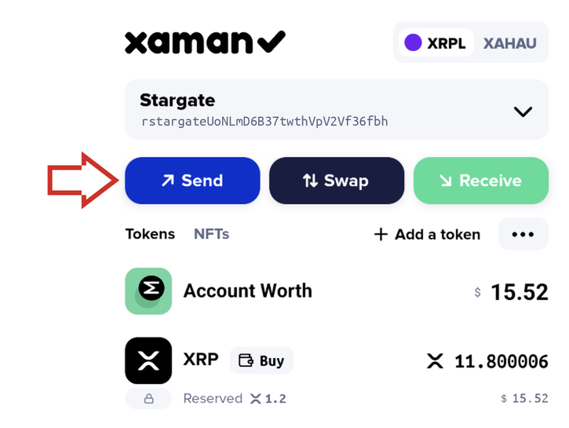
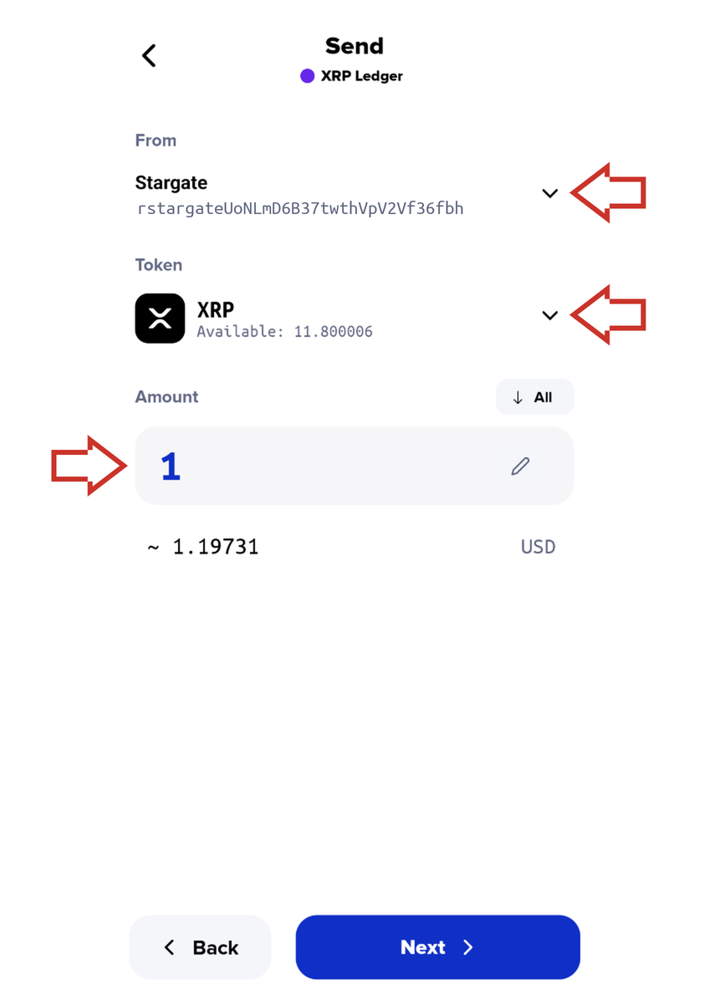
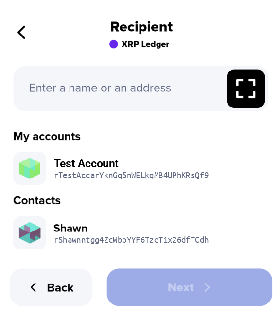
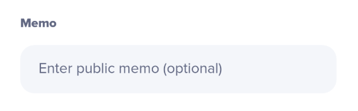

# Sending XRP and tokens from Xaman

You send XRP and tokens the same way, with the **Send** button on Xaman's home screen. Choose what to send and how much, choose who to send it to, then check the summary and slide to send.

#### Step 1: Choose what and how much to send

On Xaman's home screen, tap **Send**.

<figure><figcaption></figcaption></figure>

Choose what you want to send: XRP, or one of your tokens. Then enter the amount. If you have more than one account in Xaman, you can also choose which account to send from by tapping the down arrow beside your account.

<figure><figcaption></figcaption></figure>

Tap **Next**.

#### Step 2: Choose the recipient

Enter or select the XRP Ledger address (r-address) you're sending to.

The address is all you need when sending to a **self-custodial** account, like one in Xaman, where the owner holds the keys.

<figure><figcaption></figcaption></figure>

Sending to a **custodial** account, like one at a crypto exchange, usually also needs a **destination tag**. Exchanges use one address for many customers, and the destination tag tells them which customer the funds are for. You'll add it on the next screen.

Tap **Next**.

#### Step 3: Check and send


**Transactions on the XRP Ledger can't be reversed.** Once you've sent funds, they can't be recalled, so check every detail before you slide to send.


On the **Summary** screen, check every detail carefully before you send.&#x20;

* **The recipient's address.** Compare the r-address character by character with the one you were given, not just the first and last few characters. Scammers sometimes create look-alike addresses that differ only in the middle.
* **The token.** Make sure you're sending the right one. Many tokens have similar names, so check the issuer as well as the name.
* **The amount.** Check the number, including the position of the decimal point.
* **The fee.** Tap the information icon beside **Network & Service Fee** to see a breakdown of the network fee and any service fees that apply.

<figure><figcaption></figcaption></figure>

**Sending to an exchange?** Stop here: you also need to add a destination tag before you send. See Sending to an exchange below.

When everything is correct, **slide to send**. Your transaction is sent to the XRP Ledger, and usually completes within a few seconds.

#### Sending to an exchange

Sending to an exchange works the same way, with one extra step: the **destination tag**. Here's how to get it right.


**Always include the destination tag when sending to an exchange.** Without it, the exchange can't tell that the funds are yours. Transactions on the XRP Ledger can't be reversed, so getting your funds back depends entirely on the exchange's support team, and can take a long time.


1. **Get the deposit details from the exchange.** Log in to your exchange account, go to the deposit page for XRP (or the token you're sending), and choose the **XRP Ledger** network if you're asked. The exchange shows you two things: a **deposit address** (an r-address) and a **destination tag** (a number).
2. **Enter the address in Xaman.** In Step 2, enter or paste the exchange's deposit address.
3. **Add the destination tag.** On the Summary screen, tap **Add destination tag** and enter the number from the exchange.
4. **Check both.** Compare the address and the destination tag with the ones on the exchange's deposit page before you slide to send.


**Some exchanges use different names for the destination tag,** such as "Tag", "Memo" or "Deposit tag". Whatever it's called, it goes in the destination tag field, never in the Memo field.


**Sending to an exchange for the first time?** Send a small amount first, and check that it arrives in your exchange account before you send the rest. Also check the exchange's minimum deposit: amounts below it may not be credited.

#### Sending XRP

**You can't send all of your XRP.** Every XRP Ledger account must hold a minimum amount of XRP, called the reserve. Part of your balance is set aside for it, and only the rest can be sent. See [About Reserves](../xrp-ledger-resources/xrp-ledger-concepts/about-reserves.md) for how it works.

**Sending to a new account.** An XRP Ledger account only exists once it has received enough XRP to cover the base reserve. If you're sending XRP to an address that hasn't been activated yet, you need to send at least that amount, or the transaction will fail.

#### Sending tokens

**The recipient needs a trust line for the token.** An account can only receive a token once it has a trust line for that exact token, from the same issuer. If the recipient doesn't have one, the transaction fails, and the tokens stay in your account.

**Some tokens have a transfer fee.** The issuer of a token can charge a fee on every transfer of it. Check the summary screen carefully before you send.

#### Learn more about destination tags

Exchanges aren't the only accounts that can require a destination tag: any XRP Ledger account can be set up to require one. If a recipient gives you a destination tag, always include it.

For a short explanation of how destination tags work, see [Destination tags](https://help.xaman.app/app/learning-more-about-xaman/destination-tags).

#### Frequently asked questions

**I sent funds to an exchange without a destination tag. What can I do?**

Contact the exchange's support team as soon as possible, and give them the transaction details. Many exchanges can credit the funds manually, though it's up to them, and it can take time.

See: [Deposit to exchange didn't arrive](../learning-more-about-xaman/deposit-to-exchange-didnt-arrive.md)

**What is the Memo field on the summary screen for?**

<figure><figcaption></figcaption></figure>

The Memo field lets you add extra information to a transaction. For example:

* **Paying an invoice:** add the invoice number.
* **Proving you own an account:** an exchange or a bank may ask you to send a transaction with a word or phrase you've agreed on.
* **Funds sent to the wrong account:** you can send a small transaction with a message asking the owner to return them.

Memos are public. Anyone can read them on the XRP Ledger, so never put personal or sensitive information in one.


**The Memo field isn't for destination tags.** Use the **Add destination tag** button on the Summary screen instead.

