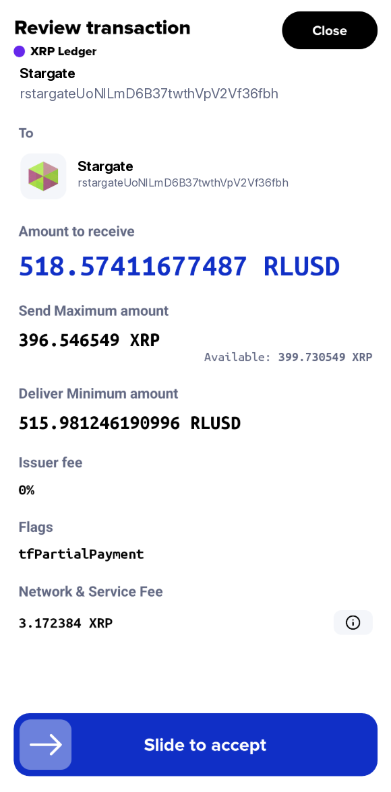
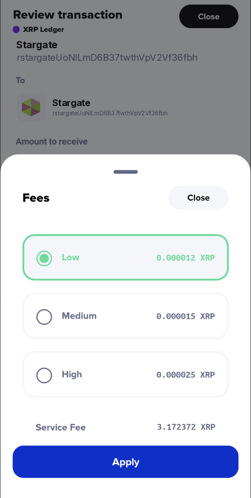

# 💙 Understanding Xaman Service Fees

**Xaman is a feature complete, secure wallet for the XRP Ledger and Xahau. A small service fee on certain transactions is how we keep building it, running the infrastructure, and supporting you. This page explains the fees, what is free, and how the fees work.**

### Transactions that are free

Most transactions are free. These transactions do not incur a service fee:

* Sending XRP or tokens up to $50,000 USD in value
* Receiving any amount of XRP or tokens
* Creating or changing trust lines (TrustSet)
* Removing trust lines
* Canceling offers
* Deleting an account on the XRP Ledger
* Minting and listing NFTs
* Trading NFTs
* Creating and voting on AMMs
* Changing account settings (AccountSet)
* Sending funds to an account you manage in Xaman

### Transactions with a service fee

A service fee applies to transactions that use extra processing or trading resources.

**Trading: 0.8%**

* Token swaps
* AMM deposits and withdrawals
* Market trades on the XRP Ledger DEX

**Yield products: 0.5%**

* Deposits into supported yield products
* Does not apply to withdrawals, reward claims, or receiving funds

**Pathfinding payments: 0.15 XRP**

* A fixed fee for pathfinding payments. These need extra calculation to find the best route for the transaction.

**High-value payments: 0.1% or 0.07%**

* Payments over $50,000 USD have a 0.1% service fee.
* Payments over $100,000 USD have a 0.07% service fee.
* These thresholds apply to large-value movements between the same source and destination within a rolling 12-hour window.

### Why This Model Exists

This fee structure brings Xaman in line with industry standards used by wallets across the XRP Ledger, Ethereum, and Solana ecosystems. By using a transparent per-use fee model, Xaman ensures:

* A sustainable and independent financial model
* No arbitrary limitations or access restrictions
* Users pay based on actual usage

These principles support Xaman’s mission to deliver best-in-class self-custodial security, ongoing innovation, and continued growth.

For more details, visit: [Building a Sustainable Future for Xaman](https://xaman.app/blog/building-a-sustainable-future-for-xaman-introducing-monetization-and-revenue-sharing)&#x20;

#### Where you will see the service fee in Xaman

Every transaction that has a service fee shows a **Network & Service Fee** line on the **Review transaction** screen. The line shows the total in XRP. That total is made of two parts: the XRP Ledger network fee, and the Xaman service fee.

To see the two parts separately:

1. On the **Review transaction** screen, tap the info icon next to the **Network & Service Fee** line.

<figure><figcaption></figcaption></figure>

2. In the **Fees** sheet, the total is broken down:

* **Network fee** : the fee paid to the XRP Ledger. You can choose the speed: Low, Medium, or High.
* **Service fee** : our fee for the transaction. The amount is already calculated and shown.

<figure><figcaption></figcaption></figure>

3. If you want a different network fee speed, select it and tap **Apply**.
4. Return to the **Review transaction** screen. Slide to accept to sign, or close to cancel.

Here is an example from a token swap. The trading rate is 0.8%, so the service fee is 0.8% of the XRP being sent:

| Part                                             | Amount       |
| ------------------------------------------------ | ------------ |
| Service fee                                      | 3.172372 XRP |
| Network fee (Low)                                | 0.000012 XRP |
| Total shown on the **Review transaction** screen | 3.172384 XRP |

If a transaction qualifies for a service fee, you will always see it before you sign.

### Frequently asked questions

**What is the difference between a Xaman service fee and an XRP Ledger network fee?**

Every transaction on the XRP Ledger pays a small network fee to the network. That fee is separate from the Xaman service fee.

* **Network fee** : paid to the XRP Ledger. It is small. It applies to every transaction.
* **Xaman service fee** : paid to Xaman. It applies only to certain transactions. This page is about our fees.

The exact service fee for your transaction is shown in the app before you confirm it. You always see the amount before you sign.

**I am sending less than $50,000. Do I pay a fee?**

No. Sending XRP or tokens up to $50,000 USD in value is free.

**I want to send more than $50,000 to an account I manage in Xaman. Do I pay a fee?**

No. Sending funds to an account you manage in Xaman does not incur a service fee, even over $50,000.

**I want to send more than $50,000 out of my Xaman account to another address. Do I pay a fee?**

Yes. A payment of XRP or tokens with a value of $50,000 USD or more from your Xaman account to another address has a 0.1% service fee. A payment over $100,000 USD has a 0.07% service fee. The app shows the exact fee before you sign.

**The fee was small last time. Why is it larger now?**

The fee depends on the size of the transaction. A larger transaction has a larger fee. The rate did not change. Only the size of your transaction changed. The app always shows the exact fee before you sign, so you can check it each time.

**Where does the service fee go?**

The service fee goes to Xaman. It funds the software, the servers and backup systems, the security work, and the support team. It is separate from the small network fee that every transaction pays to the XRP Ledger.

**I didn't know Xaman had service fees. Can I get a refund?**

Xaman has charged a service fee on covered transactions since **September 2024**, when monetization was introduced with Xaman v3.0.&#x20;

As well, before you can sign any transaction in Xaman the app displays network and service fees. You do not have to sign any transaction in Xaman unless you choose to. \
\
We do not issue refunds for our service fees. 
