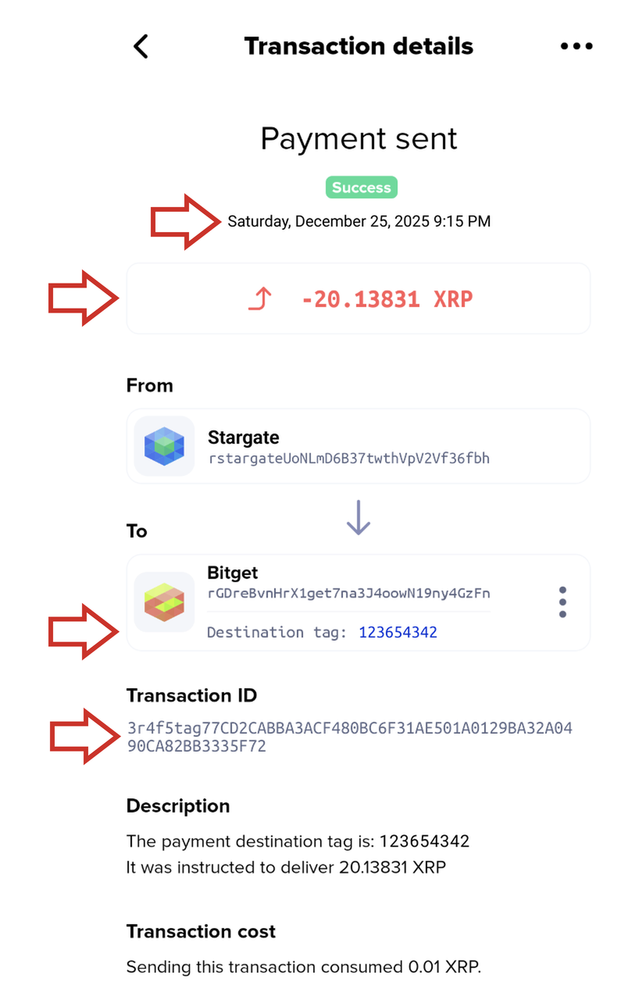

# Deposit to exchange did not arrive

#### What You Need to Send XRP to an Exchange

To deposit XRP into an exchange, you need the exchange’s **deposit address** (starts with an `r`), and, if the exchange gives you one, your **destination tag**: a number that identifies your exchange account.

_(Think of the exchange's r-address as an apartment building, and your destination tag as your specific apartment number.)_

#### Why the Deposit Hasn't Arrived

| **Reason**                     | **What happened**                                                                              | **What you should do**                                                                       |
| ------------------------------ | ---------------------------------------------------------------------------------------------- | -------------------------------------------------------------------------------------------- |
| **Missing Destination Tag**    | The exchange received the XRP, but doesn't know which account to credit.                       | Contact exchange support with your Transaction ID so they can trace the transaction.         |
| **Incorrect Destination Tag**  | The exchange received the XRP, but it credited the XRP to the wrong account.                   | Contact exchange support with your Transaction ID so they can trace the transaction.         |
| **Exchange Processing Delay**  | The XRP Ledger finished the transaction. The exchange has not processed the deposit yet.       | Check the exchange status page. The exchange usually credits the deposit within a few hours. |
| **Account or Security Hold**   | The exchange received the deposit, but has temporarily held it for internal compliance checks. | Check your email or exchange notification center for any verification requests.              |

#### How to Recover Your Funds

1. **Contact your exchange’s customer support team**

The transfer completed on the XRP Ledger. The XRP arrived at the exchange main address. Only the exchange has access to the funds and can credit your account.


A quick note on exchange policies:

Every crypto exchange has its own internal rules for dealing with missing or mistagged deposits:

* Some exchanges will locate and credit your deposit for free.
* Some charge a manual recovery fee to locate and process the funds.
* Some exchanges have strict policies refusing to recover missing deposits altogether.

These policies, fees, and processing times are determined solely by the exchange. Xaman is a self-custodial wallet interface and has no control over how third-party exchanges handle incoming transfers.


2. **Details you will need to provide**

When opening a ticket with your exchange's support team, have the following details ready:

* **Date & Time** of the transaction
* **Amount** of XRP sent
* **Transaction ID**: The unique blockchain receipt proving the transfer settled on the XRP Ledger
* **Destination Tag** entered: The number you typed in (or state clearly that you left it blank)

3. **How to find this information in Xaman**

You can locate the details the exchange needs directly in your transaction history:

1. Open Xaman and tap the **Events** tab on the home screen.
2. Scroll to and tap the specific transfer you sent to the exchange.
3. On the transaction details screen, you will see the Date, Amount, and Destination Tag (if one was included).
4. Locate the Transaction ID and tap and hold it, then tap the "Copy" button to copy it directly to your clipboard.

<figure><figcaption>
Transaction details screen
</figcaption></figure>

4. **Need to send a screenshot as proof?**

Many exchanges ask for a visual screenshot of the transaction. For your privacy and security, Xaman blocks screenshots by default. To capture one:

1. Go to Settings > Security.
2. Toggle off "Block taking screenshots".
3. Return to the Events tab, reopen the transaction details, and take your screenshot.
4. _(Recommended)_ Return to Settings > Security and turn the screenshot block back on when you're done.

#### Frequently asked questions

#### Can Xaman reverse the transaction for me?

No. Xaman sends your transaction directly to the XRP Ledger. A confirmed transaction on the XRP Ledger is final. No one, including the Xaman team, can freeze, reverse, or undo it. Only the exchange that received the funds can return or re-route them. See [Can Xaman reverse, freeze or undo a transaction?](../all-about-scams/can-xaman-reverse-freeze-or-undo-a-transaction.md).

#### Are my funds gone if I forgot the destination tag?

Not necessarily. If you sent the transfer to the correct deposit address, the exchange received the XRP in their account. Whether those funds can be credited to your account depends entirely on your exchange.

Contact your exchange's customer support team directly and explain what happened (that the transfer was sent without the tag). They will explain their specific policies, outline your available options, and let you know if there are any verification requirements or recovery fees.

#### What if I my exchange does not credit my account?

That depends on what happened.

**The Wrong Tag Belonged to Another Active Customer**

If the number you accidentally typed happens to match another user's valid destination tag, the exchange's automated system will have already credited the XRP to that person's account.

* What to expect: Crypto exchanges generally cannot unilaterally claw back funds once credited to another customer's balance. If that user has already traded or withdrawn the XRP, most exchanges explicitly state in their terms of service that they cannot assist if a mistyped tag routes funds to another user.
* What you can do: Ask support if they are willing to contact the recipient on your behalf to request a voluntary return (while preserving user privacy). Some regulated exchanges will reach out to the other customer if the funds haven't been moved, though the recipient is rarely legally forced to return them through support alone.

**The Exchange Charges a Manual Recovery Fee (or Has a Minimum Threshold)**

Sometimes an exchange won't credit your account _automatically_, or rejects a standard support ticket, because manual retrieval requires an customer service agent to trace the transaction and reconcile it by hand.

* What to expect: Many major platforms enforce a recovery fee (for example, a flat administrative fee or up to 5% of the deposit) and require the deposit to exceed a minimum threshold after fees. Rather than crediting your exchange balance, several platforms will only return the XRP to the original sending address.
* What you can do: Check whether the exchange has a dedicated Self-Service Deposit Recovery portal rather than general live chat. If you sent the XRP from _another_ exchange or custodial app (meaning the sending address isn't a personal wallet you control), ask support to hold the return until you coordinate a deposit recovery ticket with the sending platform as well.

**Standard Support Escalation & Formal Complaints**

Exchanges frequently give a scripted "blockchain transactions are irreversible" denial without realizing that a completed transaction on the XRP Ledger means the exchange itself still holds custody of your funds.

1. Re-open and escalate the ticket to a senior Tier-2 or Wallet Operations specialist. Clearly state that the transaction complete and that they are in possession of your funds.
2. Provide the XRPL Transaction Hash (TxID), the exact timestamp and amount and a screenshot from Xaman showing the transaction.&#x20;
3. Sometimes senior specialist can get your funds deposited to your account.

**File a formal complaint or regulatory escalation**

If the exchange is licensed in your jurisdiction (such as under MiCA in the EU, the FCA in the UK, or state money-transmitter/BitLicense regulators in the US) and refuses to return unallocated funds sitting in its own wallet despite proof of ownership, submit a formal complaint through their official complaints procedure, then escalate to the relevant financial ombudsman or regulator.

#### What if I sent the XRP to the wrong address (not just the wrong tag)?

An exchange only controls its own XRP Ledger addresses. If you sent the transfer to an incorrect r-address that does not belong to the exchange, their support team will not be able to help you access your funds.

Since XRP Ledger transactions are permanent and irreversible, funds sent to an unintended wallet can only be recovered if the wallet owner chooses to return them voluntarily.

**What you can try**

You can attempt to contact the wallet owner with a message on the XRP Ledger:

1. Send a small payment: In Xaman, send a very small amount of XRP (for example, `0.000001 XRP`) to the same address.
2. Add a Memo: On the Summary screen, write a short, polite message in the **Memo** field. Explain the accidental transfer. Include your Xaman r-address and ask the owner to return the funds.


Important: This is simply an on-ledger messaging attempt. There is no guarantee the recipient will check incoming transaction memos, and they are under no technical obligation to return the funds.



**Be careful:** memos are public. Anyone who contacts you offering to recover your funds for a fee is a scammer. Xaman Support will never ask for your account secret.


#### Further reading

* [Sending XRP and tokens from Xaman](../getting-started-with-xaman/sending-tokens-from-xaman.md)
