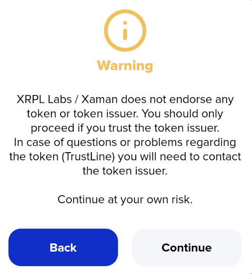

# Token vetting and the token warning

When you add a trust line for a token, or trade a token, Xaman shows this warning:

<figure><figcaption>
The warning Xaman shows for every token
</figcaption></figure>

#### Why Xaman shows this warning

Anyone can create a token on the XRP Ledger. Xaman does not vet or endorse any token or token issuer, so the warning reminds you to only continue if you trust the issuer. If you have questions or problems with a token, you need to contact its issuer.

It is only a warning, not a block. Tap **Continue** to go ahead, or **Back** to cancel.

#### For token issuers: can the warning be removed?

No. **Every token shows this warning**, and it can't be removed for any token. Xaman does not vet tokens or token issuers, so there is no application, review form, documentation, or assessment process to complete.

There are still ways to help people trust your token:

* **Publish an xrp-ledger.toml file** for your issuer domain, with your token's details, icon, and links, so wallets and explorers can display them. See [Adding an icon or logo to a trust line in Xaman](https://help.xaman.app/app/learning-more-about-xaman/adding-an-icon-logo-to-a-trust-line-in-xumm).
* **Be open about your issuer account.** Publish its address on your website, so people can check they have the real token.
* **If your token's supply is meant to be fixed,** some issuers blackhole their issuer account, so no more tokens can ever be issued. Anyone can confirm this on a ledger explorer. Blackholing is permanent and can't be undone, so only do it if you're certain.

#### Before you continue

If you're adding a token, a few checks can help you decide whether to trust it:

* **Check who issued it.** Look up the issuer's account on an XRP Ledger explorer, and make sure it matches the address on the project's official website.
* **Watch out for copycats.** Anyone can create a token with the same name as a well-known one. The name alone proves nothing; the issuer's address is what counts.
* **Be careful with unexpected tokens and airdrops.** If someone you don't know asks you to add a token, treat it with caution.
* **Never share your account secret**, whatever a token's website or community tells you.

Adding a trust line also adds to your account's reserve: each trust line currently locks 0.2 XRP.

#### Frequently asked questions

**Can my token be added to the Xaman short list?**

No. The current version of Xaman no longer has a short list of tokens, so there is no list to be added to.

#### Questions?

If you have questions about a token, contact the token's issuer. For questions about Xaman, contact us through the [Xaman Support xApp](https://xaman.app/detect/xapp:xumm.support-md) in Xaman.

