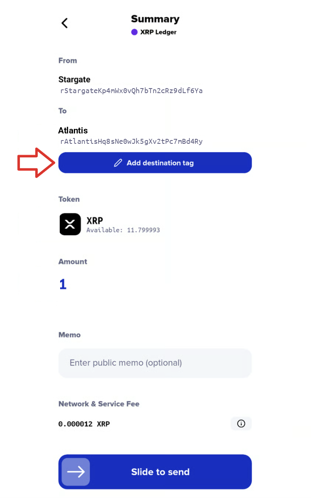

# Destination tags

### Background

A destination tag is a number you add to an [XRP Ledger](#user-content-fn-1)[^1] (XRPL) payment so the receiver knows who it is for. Think of an apartment building: the r-address[^2] is the street address, and the destination tag is the apartment number. The payment reaches the building either way, but without the apartment number, nobody knows whose door to knock on.

Exchanges and other services that hold funds for many customers often use one shared account for all of them. They give each customer a destination tag, and use it to credit each deposit to the right person. If a deposit arrives without the right tag, the exchange receives your XRP but cannot tell it is yours.

This article explains when you need a destination tag, how to add one in Xaman, and what to do if you forgot it or entered the wrong one.

### When you need a destination tag

Whether you need one depends on where your XRP is going:

* **Sending to an exchange, or another service that holds funds for you: almost always.** Copy the tag from the exchange's XRP deposit page, exactly as shown. Some exchanges call it a "Tag", a "Memo", or a "Destination Tag". In Xaman, you always enter it with the **Add destination tag** button.
* **Sending to a** [**self-custody**](#user-content-fn-3)[^3] **account, such as another Xaman account or a friend's wallet: usually not.** The account belongs to one person, so there is nobody else to tell it apart from. Leave the destination tag out unless the receiver asked you to use one.
* **Receiving into your Xaman account: no.** Your Xaman account belongs only to you, so people sending you XRP do not need a tag. If an exchange's withdrawal form will not let you continue without one, contact the exchange's support team rather than guessing a number.

### Adding a destination tag in Xaman

You send to an exchange the same way as to anyone else, with one extra step at the end. On the **Summary** screen, tap **Add destination tag**, and enter the number from the exchange's deposit page. Check that both the address and the tag match the deposit page, digit for digit, before you slide to send. [Sending XRP and tokens from Xaman](https://help.xaman.app/app/getting-started-with-xaman/sending-tokens-from-xaman#sending-to-an-exchange) walks you through every step.

<figure><figcaption></figcaption></figure>

### What the XRP Ledger checks, and what it does not

Some exchanges turn on a setting that makes the XRP Ledger reject payments without a destination tag. If you forget the tag when sending to one of these accounts, the payment fails, nothing is sent, and you can try again with the tag. That is the best possible outcome of a forgotten tag.

The XRP Ledger cannot tell whether a tag is the right one, though. If you enter a wrong tag, or the exchange does not require one and you leave it out, the payment goes through. Your XRP arrives in the exchange's account, but the exchange may not know which customer it belongs to.


A missing or wrong destination tag can leave your deposit uncredited at the exchange. Getting it credited means contacting the exchange's support team, which can take days. Copy the tag exactly from the exchange's deposit page every time you send.


### If you forgot the tag or used the wrong one

Do not send the payment again, since a second payment would end up in the same place. Your XRP has almost certainly arrived in the exchange's account, and the exchange is the only one who can credit it to you.

To get your deposit credited:

1. In **Events**, tap the payment to open its **Transaction details** screen, and copy the number under **Transaction ID**.
2. Contact the exchange's support team through its official website or app.
3. Give them the [transaction ID](#user-content-fn-4)[^4], the amount, the date and time, and your exchange account details.
4. Ask them to credit the deposit to your account.

Most exchanges can credit a deposit like this once they confirm it is yours, though it can take some time. Xaman cannot reverse the payment or move it for you, since it is already in an account the exchange controls. Be careful of anyone who contacts you offering to recover the deposit for a fee. Only the exchange can credit it. See [Recovery scams](https://help.xaman.app/app/all-about-scams/recovery-scams).

### Frequently asked questions

**Does my Xaman account have a destination tag?**

No. Your Xaman account is yours alone, so it does not need one. When you send to your own Xaman account, from an exchange or anywhere else, you can leave the tag empty.

**What is the difference between a destination tag and a memo?**

A destination tag is a number that tells the receiver who a payment is for. A memo is an optional note attached to a payment. Some exchanges label their destination tag "Memo", but in Xaman it always goes in with **Add destination tag**, never in the **Memo** field. A tag entered as a memo will not be read as a destination tag.

**Why can a destination tag only contain numbers?**

On the XRP Ledger, a destination tag is always a whole number, from 0 to 4,294,967,295. Letters are not allowed. If an exchange shows you a tag or memo with letters in it, check that you chose the XRP Ledger network on the exchange's deposit page.

**What is a source tag?**

A source tag works the other way around. It tells the receiver where a payment came from, so they know where to send it back if they return it. Most people never need to enter one.

**What is an X-address?**

An X-address is a longer address that combines an r-address and a destination tag into one. When you send to an X-address, the tag is already included. Some exchanges show X-addresses instead of a separate address and tag.

**Can I reuse a destination tag from an earlier deposit?**

Many exchanges give each customer a tag that never changes, but not all of them do. Copy the address and tag from the exchange's deposit page each time you send, to be sure they are still current.

### See also

* [Sending XRP and tokens from Xaman](https://help.xaman.app/app/getting-started-with-xaman/sending-tokens-from-xaman)
* [Deposit to exchange didn't arrive](https://help.xaman.app/app/learning-more-about-xaman/deposit-to-exchange-didnt-arrive)
* [Can Xaman reverse, freeze or undo a transaction?](https://help.xaman.app/app/all-about-scams/can-xaman-reverse-freeze-or-undo-a-transaction)
* [Recovery scams](https://help.xaman.app/app/all-about-scams/recovery-scams)

[^1]: A public network, run by independent computers around the world, that records who owns what. XRP is its native coin.

[^2]: Your account's address on the XRP Ledger. It always starts with "r", and it is safe to share.

[^3]: You alone hold the keys to your account. No company, including Xaman, can move, freeze, or recover your funds for you.

[^4]: A transaction's unique ID, also called a transaction hash. It helps you find the transaction in an explorer, or show support which one you mean.
