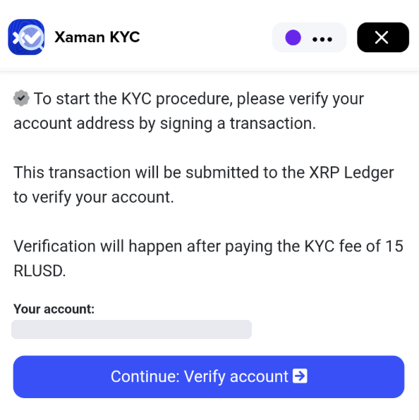

# How to verify your identity (KYC)

KYC stands for **Know Your Customer**: the process of confirming who someone is. In Xaman, verifying your identity is **optional**.


**You do not need to complete KYC to use Xaman.** Xaman is a self-custody wallet: you hold your own keys, and you can send, receive, and manage your assets without verifying your identity.


### What is KYC?

Banks, payment companies, and other regulated financial services must identify their customers and verify their identity before doing business with them. This helps keep fraud and crime out of the financial system.

Many governments now apply the same rules to crypto, which is why most crypto exchanges ask their customers to complete KYC. Rules for self-custody wallets like Xaman vary from country to country and are still developing, so identity verification may become more common in the future.

### Why would I verify my identity?

Verifying your identity links your verified identity to an XRP Ledger account you own. People choose to do this because:

* it shows that a real, verified person is behind the account, which many people value when dealing with others financially
* some services and xApps only work with verified accounts

Verification is handled by our professional verification partner, Veriff.

### What you need

You need a valid, official government-issued document. In most countries, you can use one of these:

* passport
* driver's license
* national ID card
* residence permit

Supported documents differ by country. See Veriff's [list of supported documents and countries](https://www.veriff.com/supported-countries).

You also need:

* **Full access** to the account you want to verify. See _Can I verify an account I added in Read only mode?_ below.
* **15 RLUSD** in that account, to pay the KYC fee. To hold RLUSD, the account needs an RLUSD trust line.

### How to verify your identity

1. In Xaman, select the account you want to verify.
2. Open the [Xaman KYC xApp](https://xaman.app/detect/xapp:xumm.kyc).  

<figure><figcaption></figcaption></figure>

1. Check that the account under **Your account** is the one you want to verify, then tap **Continue: Verify account**.
2. Review and sign the transaction. It pays the 15 RLUSD KYC fee and proves that the account is yours.
3. Follow the instructions in the xApp to verify your identity with Veriff. This usually includes taking a photo of your ID document and of yourself.

### Frequently asked questions

**Do I have to complete KYC to use Xaman?**

No. KYC is entirely optional. You can use Xaman without verifying your identity.

**Can I verify an account on a Xaman card?**

Yes. Sign the KYC transaction with your card, just like any other transaction.

**Will Xaman share my identity with anyone?**

Xaman does not share your personal information with third parties, unless the law requires it. Our [privacy statement](https://help.xaman.app/app/about-xaman-and-xrpl-labs/where-can-i-find-your-privacy-statement) explains what personal data we process and why.

**Can I verify an account I added in Read only mode?**

No. Anyone can add any XRP Ledger account to Xaman in **Read only** mode, so a Read only account doesn't prove that the account is yours. KYC links your identity to an account **you own**, so you need **full access** to it: the account's secret must be in Xaman, or the account must be on your Xaman card.

For the same reason, you cannot verify a blackholed account, since no one can sign for it.

### Questions?

If you have questions about KYC, contact us through the [Xaman Support xApp](https://xaman.app/detect/xapp:xumm.support-md) in Xaman.
