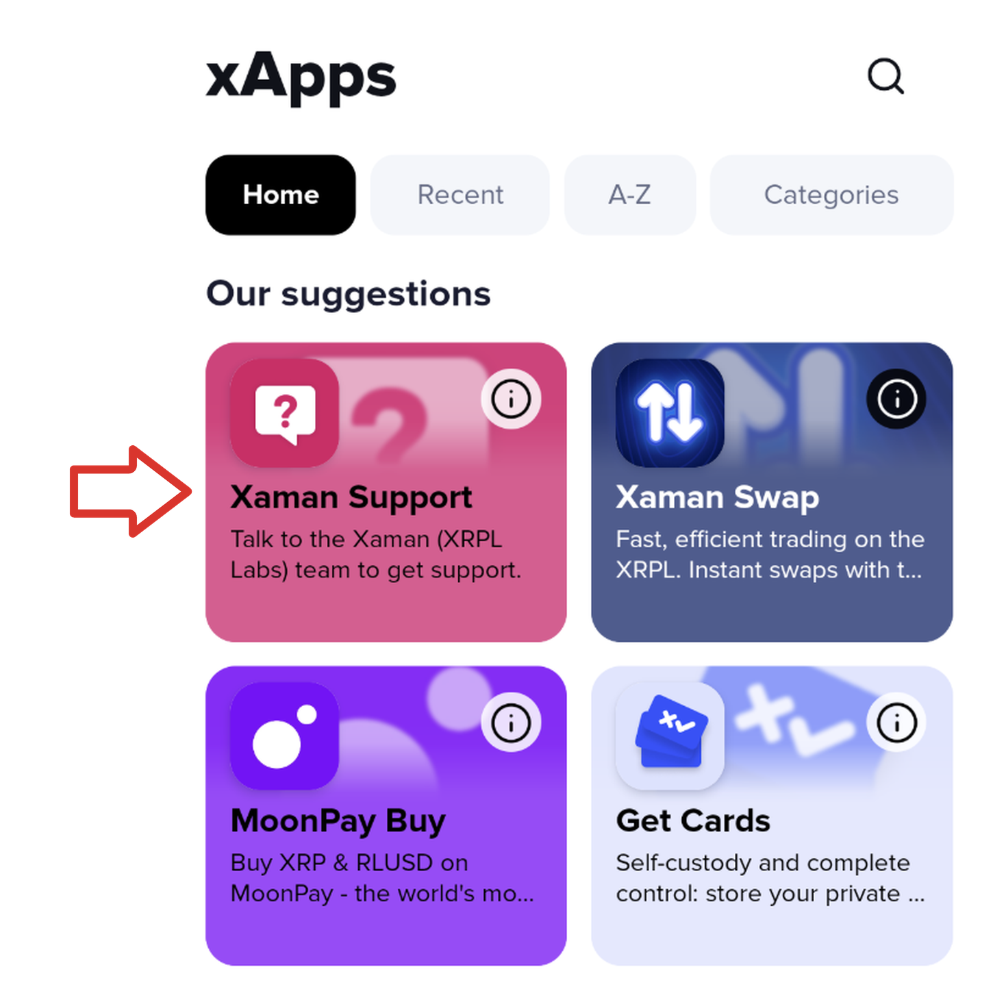

# Official communication channels

### Background

Scammers often pretend to be Xaman, because people trust the name with their funds. They copy our logo, open look-alike accounts on social media, and message people who have posted a question in public. This page lists every official place to find Xaman, so you can check any message, website, or account against it. It applies to Xaman on both the XRP Ledger (XRPL) and Xahau.

The short version is easy to remember: real Xaman support only happens inside the Xaman app. If someone reaches you anywhere else claiming to be Xaman support, it is not us.

### Getting help from Xaman support

The Xaman Support xApp is the only official way to contact our support team. It opens inside Xaman, so you always know you are talking to us. To find it, tap **xApps** in the bottom navigation bar, then tap **Xaman Support** under **Our suggestions**. You can also use the button below. Suggestions and feedback are welcome there too.

<a href="https://xaman.app/detect/xapp:xumm.support-md" class="button primary">Open the Xaman Support xApp</a>

<figure><figcaption>
Xaman Support is first under Our suggestions
</figcaption></figure>


People posing as Xaman support will ask for your account secret or a signature. Anyone who gets either can take your funds. Ask for help only through the Xaman Support xApp, and never share your account secret.


### If you only have a Read only account

To open a support ticket, you need a **Full access** account in Xaman. When you open a ticket, the Xaman Support xApp asks you to sign in with a signature, which confirms the account really is yours. The sign-in costs nothing and records nothing on the XRP Ledger. It can only come from an account whose account secret or Xaman card is in Xaman. A **Read only** account has neither, and since anyone can add any r-address in Read only mode, it cannot prove the account is yours.

There are two ways to get a Full access account, depending on what you have:

* **You have the account secret: convert the account.** Add the account secret in Xaman, and the same account becomes Full access. [_How to convert a Read only account to Full access_](../your-accounts/importing-your-account/how-to-convert-a-read-only-account-to-full-access.md) walks you through it.
* **You do not have the account secret: create a new account.** Create a new account in Xaman. It does not need any XRP to open a ticket, so you can do this right away.

Once you have a Full access account, open the Xaman Support xApp from it, and tell us which account you need help with. Our replies arrive privately in your **Events** tab.

### Where Xaman does not offer support

Xaman does not offer support on social media, by email, or by phone. That includes X, Telegram, Instagram, Discord, and YouTube. Fake support accounts appear on all of them, and some look very convincing, with our logo and a name like "Xaman Support" or "Xumm Support".

When someone on one of these platforms offers to help, do not reply, do not click their links, and do not fill out any form they send. Our support team will never ask for your [account secret](#user-content-fn-1)[^1]. Anyone who asks for it is trying to take your funds, so never share it.

### Official websites and accounts

These are the official places to find Xaman and XRPL Labs, the company behind it:

| Channel            | Address                | What it is for                                                             |
| ------------------ | ---------------------- | -------------------------------------------------------------------------- |
| Xaman Support xApp | Inside the Xaman app   | Support, questions, and feedback                                           |
| Xaman Help Center  | `help.xaman.app`       | How-to articles and answers, like this one                                 |
| Xaman website      | `xaman.app`            | About Xaman and its features                                               |
| Xaman blog         | `xaman.app/blog`       | Announcements and longer updates                                           |
| Status page        | `status.xrpl-labs.com` | Whether Xaman's services are running normally                              |
| Developer docs     | `docs.xaman.dev`       | Documentation for developers who build on Xaman                            |
| Source code        | `github.com/XRPL-Labs` | Xaman's public code                                                        |
| Xaman on X         | `@XamanWallet`         | Announcements only, never support                                          |
| XRPL Labs on X     | `@XRPLLabs`            | Company news, never support                                                |
| Wietse Wind on X   | `@WietseWind`          | The founder of XRPL Labs. Never support, and he will not message you first |

Install Xaman only from the official app stores: [Xaman on the App Store](https://apps.apple.com/app/xaman/id1492302343) for iPhone, and [Xaman on Google Play](https://play.google.com/store/apps/details?id=com.xrpllabs.xumm) for Android.

### Official domains

Xaman's official domain is `xaman.app`, including its subdomains, such as `help.xaman.app`. You may also see `xumm.app`, the domain from before Xaman was renamed, which some older links still use. Developer documentation lives at `docs.xaman.dev`, and the status page at `status.xrpl-labs.com`.

Scammers often build phishing[^2] sites with addresses that look almost the same, such as an extra letter or a different ending. Check the address character by character before you sign in, scan a code, or sign anything. If anything about it looks different from the list above, close the page.

### Frequently asked questions

**Someone messaged me saying they are from Xaman. What should I do?**

Do not reply, and do not click anything they send. Xaman support does not reach out on social media or by direct message, so the message is not from us. If you want to check, ask us in the Xaman Support xApp. You can also tell us about the account there, so we can warn others.

**I only have a Read only account. How do I contact support?**

You need a Full access account, since the Xaman Support xApp asks for a sign-in signature that only a Full access account can give. If you have the account secret, convert your account to Full access. If not, create a new account in Xaman, which does not need any XRP, then open the Support xApp from it. See _If you only have a Read only account_ for both options.

**I already shared my account secret with someone. What now?**

Act quickly, since anyone who has your account secret can move your funds. _I've been scammed!_ walks you through the steps to protect what is left.

### See also

* [I've been scammed!](ive-been-scammed.md)
* [Recovery scams](recovery-scams.md)
* [Trust in the XRPL Community](trust-in-the-xrpl-community.md)
* [Security in Xaman](../security/security-in-xaman.md)
* [About XRPL Labs](../about-xaman/what-is-xrpl-labs.md)
* [How to convert a Read only account to Full access](../your-accounts/importing-your-account/how-to-convert-a-read-only-account-to-full-access.md)
* [How to create an XRP Ledger account](../getting-started-with-xaman/what-is-xaman/how-to-create-an-xrpl-account.md)

[^1]: The secret that controls your account, as Secret Numbers, a Family Seed, or a Mnemonic. Never share it with anyone.

[^2]: A fake website, message, or app that copies a real one, to trick you into signing something or sharing your account secret.
