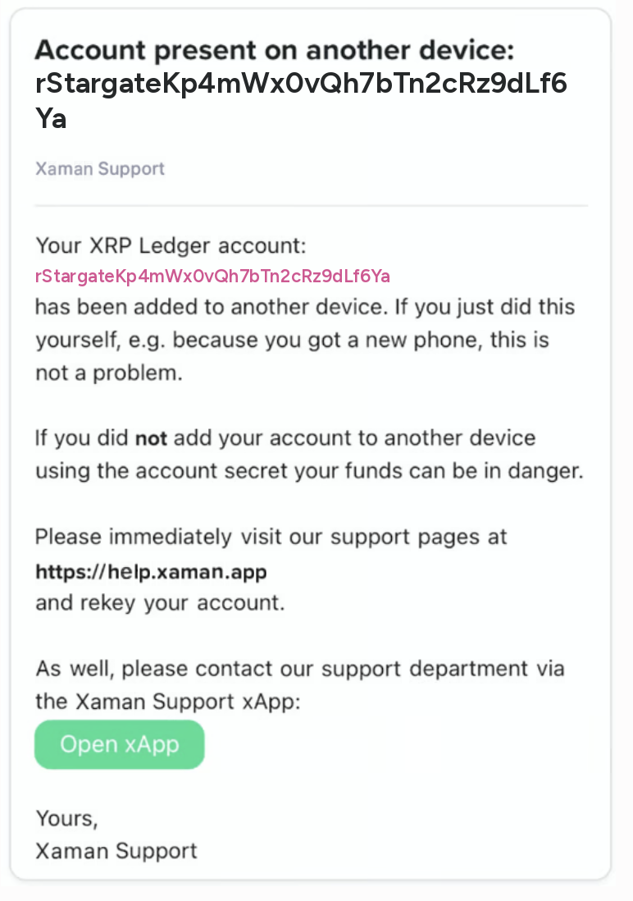

# Account present on another device

Background

Xaman shows this warning when one of your accounts is added to Xaman on another phone or tablet. Most of the time there is a simple explanation: you set up a new phone and imported your account yourself. If you did not, the warning matters a great deal, because it means someone else has your account secret. This article helps you work out which case you are in, and walks you through what to do right away if it was not you.

Xaman is a self-custody wallet. Only you hold your account secrets, so we cannot freeze your account, block the other device, or reverse a transaction. What we can do is warn you, and that is what this message is for.

### What you see

The warning arrives in **Xaman Messages**, titled with your account's r-address. It looks like this:

<figure><figcaption></figcaption></figure>

### Why it happens

Xaman shows this warning in one of two situations. Either you installed Xaman on a new phone or tablet and imported your account there, or someone else imported your account secret into Xaman on their own device. To Xaman, both look the same: an account that has appeared on a device it has not been on before.

Xaman cannot tell you who added your account, where the device is, or what kind of device it is. We do not collect personal information, so that information simply does not exist on our side. Only you can tell whether the new device is yours.

### What you can do

#### If you added your account to a new device

You do not need to do anything. The warning is Xaman letting you know that your account is now on more than one device, which is exactly what you did. If you no longer use the old device, consider removing the account from it, so fewer devices hold your account secret.

#### If you did not add your account to a new device

Treat this as an emergency. Someone else has your account secret, and they can move your funds at any moment, from their own device. Every minute counts, so protect your funds first and investigate afterward.


Someone else can control your account. Anything left in it can be taken at any moment, and a stolen transaction cannot be reversed. Lock the other device out now, before you do anything else.


Act now, using one of these two options. Either one works, so choose the one you can do fastest.

**Option 1: Rekey your account, then disable the master key.**&#x20;

This stops your old account secret from working, so the other device can no longer sign anything for your account. Rekeying gives your account a new key that only you hold, and it has to come first: the XRP Ledger only lets you disable the master key once a new key is in place. Follow these two articles in order:

* [How to rekey your account](../../learning-more-about-xaman/how-to-rekey-your-account.md)
* [How to disable the master key](../../learning-more-about-xaman/how-to-disable-the-master-key.md)

**Option 2: Move your funds to another account that only you control.**&#x20;

Send all your XRP and tokens there, then stop using the old account. If you create a new account for this, write its account secret down on paper only, and keep it somewhere private. Until you know how your old account secret got out, avoid saving the new one in photos, notes, or anywhere else digital, and make sure no one can see your screen while you write it down. A Xaman card account is another good choice, since its account secret never leaves the card. This article shows you how to send your funds:

* [Sending XRP and tokens from Xaman](../../getting-started-with-xaman/sending-tokens-from-xaman.md)

**Not sure which to choose?** Contact us through the [Xaman Support xApp](https://xaman.app/detect/xapp:xumm.support-md), and we will help you decide. Xaman Support will never ask for your account secret.

### Find out how your account secret got out

Once your funds are safe, it is worth working out how someone got your account secret, so it cannot happen again. Account secrets usually leak in ordinary ways that are easy to miss. Go through these questions honestly, and take your time:

* Did you ever type your account secret into a website, a form, another wallet, or an "airdrop" or "validation" page?
* Is your account secret saved anywhere digital, such as a photo, a screenshot, a note, an email, or a cloud backup?
* Did you share your account secret with anyone, including someone who said they were from support?
* Did you recently install a new app, a browser extension, or a file from outside the official stores?
* Did anyone ask you to install a screen-sharing or remote-access app?

If you cannot find the cause, check your phone for apps you do not recognize, especially screen-sharing or remote-access apps, and remove them. See [Security in Xaman](../../security-and-xaman/all-about-security/how-secure-is-xaman.md) for the habits that matter most.

### Frequently asked questions

**Can Xaman tell me who added my account?**

No. Xaman can only tell that your account appeared on a device it had not seen before. We do not collect personal information, so there is no name, location, or device type to share.

**Can Xaman block the other device?**

No. Anyone who has your account secret can use it in any wallet, not only in Xaman, so blocking one device would not protect you. Moving your funds to a safe account, or rekeying your account, is what protects you.

**My funds are already gone. What should I do?**

Stop using the account, and create a new account on a device you trust. Report the theft to your local police or national cybercrime authority, with your r-address and the transaction details. Be careful of anyone who contacts you offering to recover your funds, including people claiming to be investigators. Recovery scams often target people who have just lost crypto. See [I've been scammed!](../../all-about-scams/ive-been-scammed.md)

**Will Xaman support ask for my account secret to help me?**

Never. Xaman support never asks for your account secret, and anyone who does is a scammer. If you need help, contact us through the [Xaman Support xApp](https://xaman.app/detect/xapp:xumm.support-md).

### See also

* [Security in Xaman](https://help.xaman.app/app/security-and-xaman/all-about-security/how-secure-is-xaman)
* [How to create an XRP Ledger account](https://help.xaman.app/app/getting-started-with-xaman/your-first-xrp-ledger-account/how-to-create-an-xrpl-account)
* [How to rekey your account](https://help.xaman.app/app/learning-more-about-xaman/how-to-rekey-your-account)
* [How to disable the master key](https://help.xaman.app/app/learning-more-about-xaman/how-to-disable-the-master-key)
* [Sending XRP and tokens from Xaman](https://help.xaman.app/app/getting-started-with-xaman/sending-tokens-from-xaman)
* [I've been scammed!](https://help.xaman.app/app/all-about-scams/ive-been-scammed)
