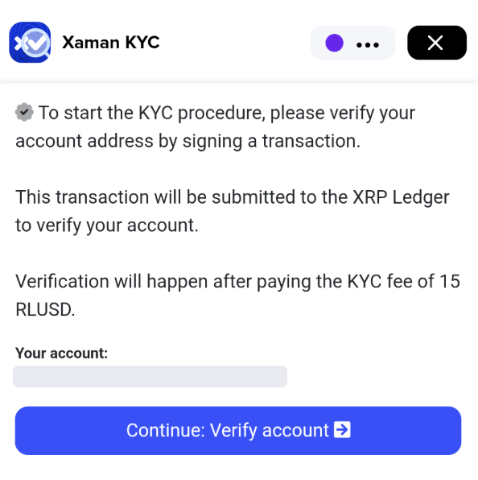

# How to verify your identity (KYC)

Background

KYC stands for Know Your Customer: the checks a company runs to confirm who someone is. In Xaman, verifying your identity is optional. Xaman is a self-custody[^1] wallet, so you hold your own keys, and you can send, receive, and manage your assets without ever verifying who you are. Some people choose to verify anyway, and this article explains why, what you need, and how it works.&#x20;

Banks, payment companies, and other regulated financial services must check who their customers are before they do business with them. These checks help keep fraud and crime out of the financial system. Many governments now apply the same rules to crypto, which is why most exchanges ask you to complete KYC when you sign up. Rules for self-custody wallets differ from country to country and are still changing, so you may meet identity checks more often in the future.

### Before you get started

You need these four things:

* A **Full access** account: its [account secret](#user-content-fn-2)[^2] is in Xaman, or the account is on your Xaman card.
* A valid government-issued ID document, such as a passport, driver's license, national ID card, or residence permit. Supported documents differ by country: see [Supported countries and documents (Veriff)](https://www.veriff.com/supported-countries).
* 15 RLUSD in the account you want to verify, to pay the KYC fee. To hold RLUSD, the account needs an RLUSD [trust line](#user-content-fn-3)[^3]: see [How to create a RLUSD Trust Line](../tokens-trust-lines-and-nfts/how-to-create-a-rlusd-trust-line.md).
* The phone where Xaman is installed, with a working camera for the photos.

### Why verify your identity

Verifying links your identity to an XRP Ledger account you own. People choose to do it for two reasons:

* **Trust from others.** A verified account shows that a real person is behind it, which many people value when they deal with someone financially.
* **Access to services.** Some services and xApps[^4] only work with verified accounts.

Xaman works with Veriff, a professional identity verification company, to check your document and your photo. Veriff sees your ID, never your keys. Verification works by signing a transaction from your account, and a signature proves the account is yours without revealing anything that controls it. That is also why the fee is paid from the account itself: the payment and the proof are the same transaction.

### Verify your identity

1. On the **Home** screen, select the account you want to verify.
2. Open the [Xaman KYC xApp](https://xaman.app/detect/xapp:xumm.kyc) on the phone where Xaman is installed.
3. Check that the account under **Your account** is the one you want to verify.
4. Tap **Continue: Verify account**.
5. Review the transaction, then sign[^5] it. The transaction pays the 15 RLUSD KYC fee and proves that the account is yours.
6. Follow the steps in the xApp to verify your identity with Veriff.

<figure><figcaption>
The first screen of the Xaman KYC xApp
</figcaption></figure>


Verification never needs your account secret. Anyone who asks for it during KYC can take control of your account and its funds. Share only your ID document and photos, and only inside the Xaman KYC xApp.


### Frequently asked questions

**Do I have to complete KYC to use Xaman?**

No. You can send, receive, and manage your assets in Xaman without verifying your identity. Verification matters only for the services and xApps that ask for a verified account.

**Can I verify an account on a Xaman card?**

Yes. An account on a Xaman card has **Full access**, so you sign the KYC transaction with your card, the same way you sign any other transaction.

**Can I verify an account I added in Read only mode?**

No. Anyone can add any XRP Ledger account to Xaman in **Read only** mode, so a Read only account does not prove that the account is yours. KYC links your identity to an account you own, which is why it needs **Full access**. For the same reason, you cannot verify a [blackholed account](#user-content-fn-6)[^6], since no one can sign for it.

**Will Xaman share my identity with anyone?**

Xaman does not share your personal information with third parties, unless the law requires it. Our [Privacy Statement](../about-xaman/where-can-i-find-your-privacy-statement.md) explains what personal data we process and why.

**I took part in Fractal ID's 11 XRP reward. Who can help me with it?**

Fractal ID ran that reward program with Ripple, and it ended on October 20, 2023. Xaman was never part of the program, so we have no records of who qualified or which rewards were paid. Fractal ID's own support team is the only one that can look into a missing reward, and you can reach them through Fractal ID's website. No one helping you ever needs your account secret, so never share it.

**Who can help if something goes wrong during verification?**

Our support team can, through the Xaman Support xApp. It is the only official way to contact Xaman support, and we do not offer support through social media. No one on our team will ever ask for your account secret.

<a href="https://xaman.app/detect/xapp:xumm.support-md" class="button primary">Open the Xaman Support xApp</a>

### See also

* [Understanding self-custody](../getting-started-with-xaman/what-is-xaman/understanding-self-custody.md)
* [What do "Full" and "Read Only" mean in Xaman?](../getting-started-with-xaman/what-is-xaman/what-do-full-and-read-only-mean-in-xaman.md)
* [How to create a RLUSD Trust Line](../tokens-trust-lines-and-nfts/how-to-create-a-rlusd-trust-line.md)
* [What is a blackholed account?](../xrp-ledger-basics/xrp-ledger-concepts/what-is-a-blackholed-account.md)

[^1]: You alone hold the keys to your account. No company, including Xaman, can move, freeze, or recover your funds for you.

[^2]: The secret that controls your account, as Secret Numbers, a family seed, or a recovery phrase. Never share it with anyone.

[^3]: Your account's permission to hold a specific token from a specific issuer. Each one adds to your reserve while it exists.

[^4]: A small app that runs inside Xaman, made by Xaman or by other developers.

[^5]: Approving a transaction with your account's key. In Xaman, you slide to accept and confirm with your passcode or biometrics.

[^6]: An account that has given up every way of signing, on purpose and for good. Many token issuers do this to fix their token's supply.
