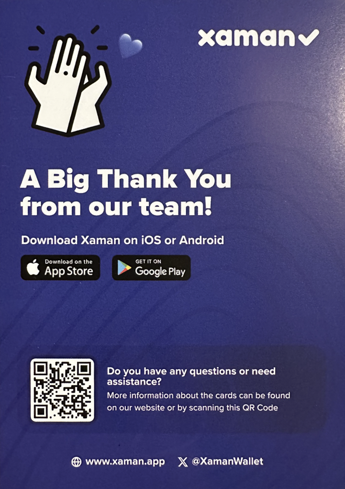
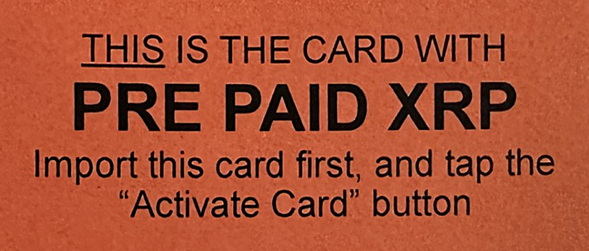
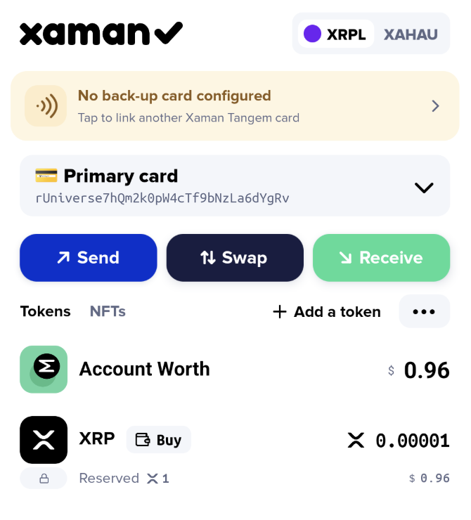
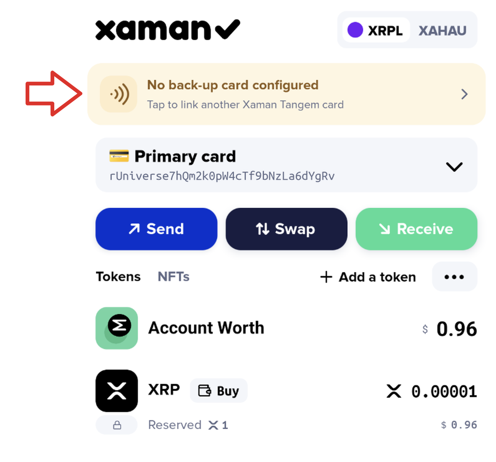
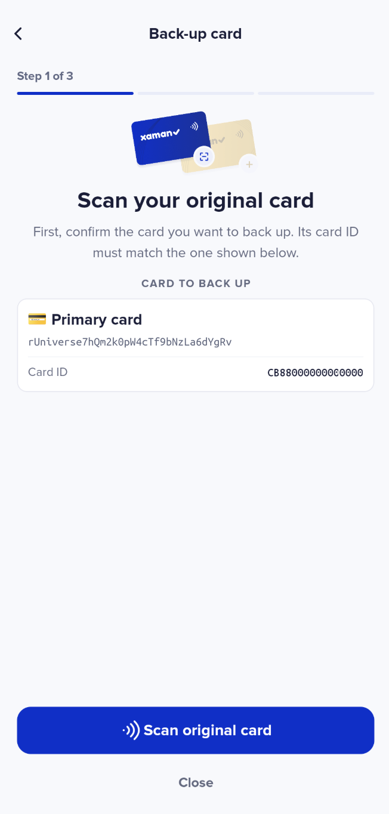
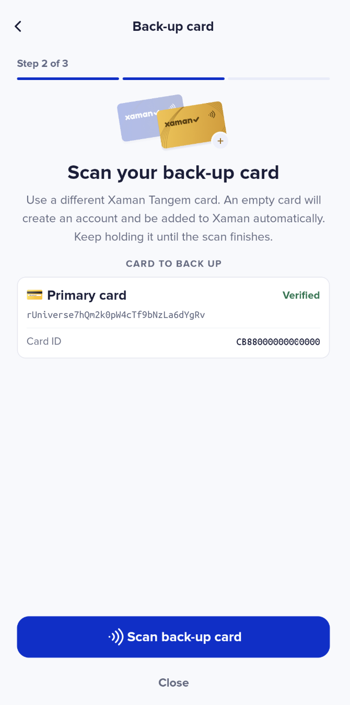
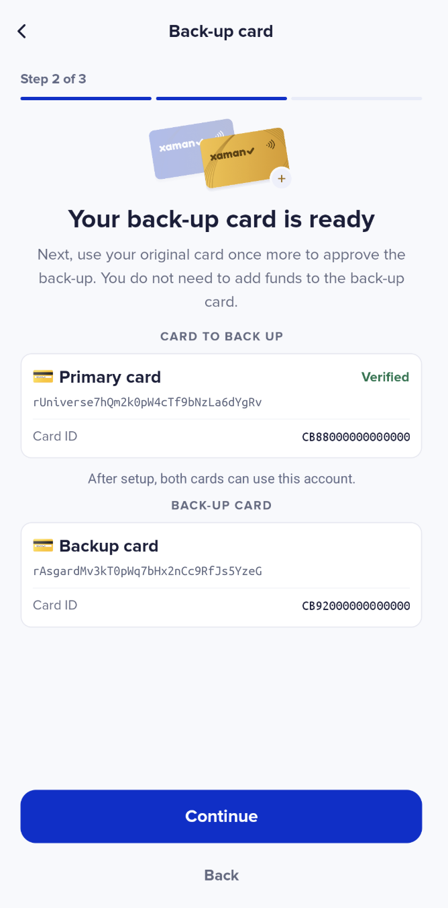
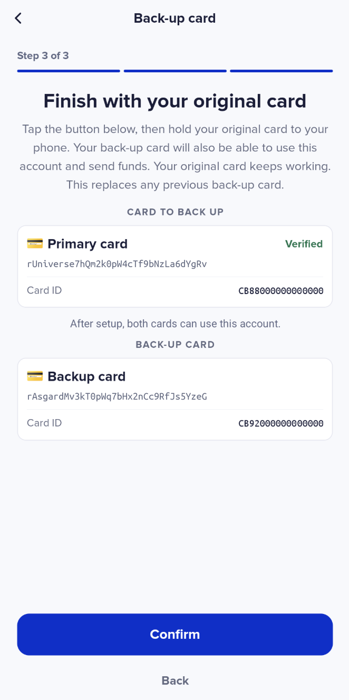
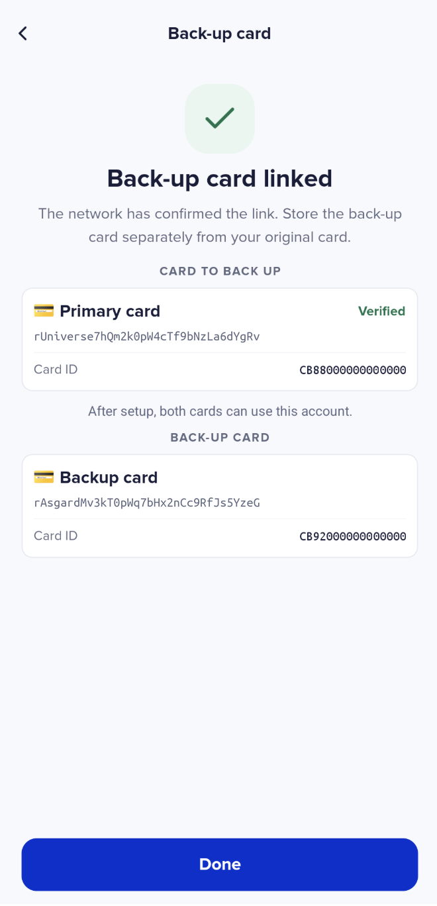

# Setting up your Xaman cards

### Background

Your Xaman cards have arrived, so let's open the package together. In about ten minutes, you go from a sealed pouch to a working cold-wallet setup: two cards, one account, and your XRP protected by a card you can hold in your hand. This article walks you through every step, from your first tap to linking your Backup card. Along the way, it explains why you have two cards and what each one is for.

### What is in your package

Your package arrives in a sealed pouch, and the cards inside are loose. That is normal, so there is no need to worry when they slide out. Inside, you find:

* **At least two cards**, in the designs you picked when you ordered.
* **A printed instruction sheet**, which covers the same setup as this article in less detail.
* **A thank-you card**, with links to download Xaman from the App Store or Google Play.

<figure><figcaption>
Thank you card
</figcaption></figure>

If your package arrived already opened, see [Are my Xaman cards safe?](../xaman-cards/are-my-xaman-cards-safe.md) before you go any further.

### Your pre-funded card

One of your cards comes in a clear plastic sleeve with an orange label telling you to import it first. This is your pre-funded card (the label calls it "pre paid"). It comes with enough XRP to activate its account, so you do not need to buy any XRP to get started. The sleeve is only there so you can spot the card, and it does not change how the card works.

<figure><figcaption>
This label marks the card to import first
</figcaption></figure>

Whichever designs you picked, every card works exactly the same way, including partner ecosystem cards. The only difference is that one card comes pre-funded. That card becomes your Primary card, the one your XRP lives on.

### Before you get started

Check that you have these ready:

* A phone with NFC (the same technology used for tap-to-pay), with NFC turned on.
* An up-to-date version of iOS or Android.
* The latest version of the official Xaman app from the [App Store](https://apps.apple.com/app/id1492302343) or [Google Play](https://play.google.com/store/apps/details?id=com.xrpllabs.xumm).


Already have an XRP Ledger account in Xaman? Read [How to link an existing account to a Xaman card ](../xaman-cards/how-to-link-an-existing-account-to-a-xaman-card.md)before you start. It helps you decide whether to keep your existing account or move everything to a new card account.


### How two cards protect one account

Here is the one thing worth understanding before you start: each new card creates and holds its own account. A brand-new card holds no account at all. When you import it, the card creates the keys for a new XRP Ledger account inside its chip. That account only becomes active on the XRP Ledger once it receives XRP. So right after you import both cards, you have two different accounts, not one.

Your pre-funded card becomes your Primary card, and your XRP lives on its account. You then link your other card to it as your Backup card. (The printed sheet in your package calls it the Signing card, and it is the same thing.) Once they are linked, both cards can sign for the same Primary account.

Think of it as two keys to the same door. The Primary card is the master key, and the Backup card is a second key to that same door. You can use either one to get in, which is exactly what protects you if one of them goes missing.


If you lose the Backup card, use your Primary card to remove its link, then keep using your Primary card. If you lose the Primary card, use your Backup card to move your assets from the Primary card account to another account. Write down your Primary account's r-address and keep it somewhere safe, since you need it to reach your account with the Backup card if you ever lose your phone and your Primary card together. See [Lost or damaged cards](../xaman-cards/lost-or-damaged-cards.md).


### What Xaman cards do, and what they do not

A Xaman card is a physical card with a secure chip inside. It does three jobs: it creates an account secret, it keeps that secret inside the chip, and it signs transactions for the account it created. The account secret never leaves the chip. It never touches your phone, and Xaman never sees it.

That is what makes the cards so strong, and it also means you should treat them like cash or house keys. Anyone who holds one of your linked cards can use it to sign for your account. Xaman is a self-custody wallet, so we cannot recover a lost card, freeze your account, or reverse a transaction for you.

The cards are not bank cards. You cannot use them at an ATM, as a debit or credit card, or to connect to a bank account. They do one thing only, which is to protect and control your accounts on the XRP Ledger and Xahau.

### Set up your cards

The whole setup takes about ten minutes. Follow the steps in order, since each one builds on the last.

#### Import your pre-funded card

Take the pre-funded card out of its sleeve, and import it first.

1. Tap **Settings** > **Accounts**.
2. Tap **+ Add account**.
3. Tap **Add Xaman Tangem card**.
4. Follow the instructions on the screen.
5. Tap **Activate your account** to claim the XRP on your pre-funded card.

This account is now your Primary account. For more detail, see [How to import your Xaman card](../getting-started-with-xaman/importing-your-account/...a-xaman-tangem-card.md).


If Xaman warns that a card was used before, stop. Someone else may already control a used card, and anything you send to it could be taken. Do not import that card, and contact us through the [Xaman Support xApp](https://xaman.app/detect/xapp:xumm.support-md) before you do anything else.


<figure><figcaption>
Your Primary account is now active
</figcaption></figure>

You will see XRP in your balance, but you cannot spend it. An account becomes active on the XRP Ledger only when it receives XRP, and from then on it must keep a minimum balance, called the reserve. The XRP on your pre-funded card covers that reserve for your Primary account. Your Backup card does not need one, since it never holds funds of its own. It only signs for your Primary account. The reserve is a rule of the XRP Ledger, not a Xaman fee. For more,

#### Set up your second card as the Backup

Once your Primary account is active, Xaman reminds you that it has no Backup card yet. The reminder is not an error, and it stays on your Primary account until your Backup card is linked to it. If you are not ready to set up your Backup card right away, you can come back to it later. Tapping the reminder starts the Backup setup.

1. Tap **No back-up card configured**.
2. Follow the instructions on the screen to import your second card.

<figure><figcaption>
This reminder appears until a Backup card is linked
</figcaption></figure>

<figure><figcaption>
Have your second card ready before you continue
</figcaption></figure>

Your Backup card’s account does not need any XRP of its own. It never holds funds, and it only signs for your Primary account, so there is nothing to activate.

<figure><figcaption>
Scan the Backup card
</figcaption></figure>

<figure><figcaption>
Your Backup card is ready to link
</figcaption></figure>

#### Link the Backup card to your Primary account

This step is what turns two accounts into one setup. It uses an XRP Ledger feature called a regular key. A regular key is a second key that the XRP Ledger allows to sign for an account, alongside the account’s own key. Your Backup card becomes that second key for your Primary account, while your Primary card keeps full control.

1. Open the [Tangem Backup xApp](https://xaman.app/detect/xapp:xumm.tangem-backup).
2. Follow the instructions on the screen to link your Backup card to your Primary account.

<figure><figcaption>
Check that both cards are the right ones
</figcaption></figure>

<figure><figcaption>
Both cards can now sign for your Primary account
</figcaption></figure>

For more detail, see How to configure a backup signing account.

#### Move your funds to your Primary account

With both cards linked, you can send your XRP and any other assets to your Primary account. If you already had an XRP Ledger account before your cards arrived, you can move everything to the card account or keep both, and either choice is fine. For help deciding, see How to link an existing account to a Xaman card.

### Which card to carry day to day

A common setup is to keep the Primary card somewhere safe, such as a safe, a safe deposit box, or a locked drawer, and carry the Backup card for everyday signing. The Primary card is the master key to the account your money lives on, so it makes sense to keep it out of harm's way. If you lose the Backup card you carry, your Primary card removes its link and still controls everything.

Either way works, though. Once they are linked, both cards control the same account, so choose the arrangement that fits your life.

### If you have more than two cards

The regular key feature allows one Backup card per account, so a third card cannot become a second Backup for the same account. Extra cards are still useful, and people put them to work in a few ways:

* As a spare, ready to become your new Backup or Primary card if one is lost or damaged.
* As a separate account for daily spending, NFTs, trading, or testing.
* As a gift for a friend or family member.
* As part of a multi-signing setup, which is an advanced option. See _Multi-signing in Xaman_ \[VERIFY LINK].

Extra cards are not pre-funded, so you need to activate each one you plan to use as its own account.

### Frequently asked questions

**Can I use the other card as my Primary card instead?**

You can, though it takes a few extra steps after you set up both cards. First, activate the second card's account yourself by sending it at least the reserve amount of XRP. Next, delete the account on the pre-funded card, choosing your new Primary account as the destination, so its remaining XRP moves there. Finally, link the pre-funded card as your Backup card. Deleting an account costs a fee that is much larger than a normal transaction fee, and a newly activated account must wait a short while before it can be deleted. \[Uncertain] See How to activate a new XRPL account and How to delete your account.

**Why can I not spend the XRP on my pre-funded card?**

That XRP is the reserve, the minimum balance an XRP Ledger account must keep once it is active. It shows in your balance, but it stays locked for as long as the account exists. Your Backup card’s account is never activated, so it has no reserve to keep. This is a rule of the XRP Ledger, not a Xaman fee, and the network can change the amount over time.

**What if my package arrived opened?**

Do not import the cards yet. See Are my Xaman cards safe?, and contact us through the [Xaman Support xApp](https://xaman.app/detect/xapp:xumm.support-md) if you are unsure about anything.

### See also

* Best security practices for the Xaman cards \[VERIFY LINK]
* Lost or damaged cards
* How to configure a backup signing account
* How to link an existing account to a Xaman card
* Security in Xaman

Your Xaman cards have arrived! 🎉

Let’s open the package together. In about ten minutes, you will go from a sealed pouch to a working cold-wallet setup: two cards, one account, and your XRP secured by a card you can hold in your hand. We will walk you through every step, from your first tap to linking your backup.

#### **What you can expect in the package**

Your package arrives in a sealed pouch and contains:

* **At least two cards**, in the designs you picked when you ordered. The cards are loose in the pouch. This is normal.
* **A printed instruction sheet**, which covers the same setup as this article, in less detail.
* **A thank-you card** with links to download Xaman from the App Store or Google Play.

<figure><figcaption>
The thank-you card included  in every package
</figcaption></figure>

**Your pre-funded card**

One of your cards comes in a clear plastic sleeve with an orange label telling you to import it first. This is your **pre-funded card** (the label calls it "pre paid"). It comes with 1 XRP that you claim when you set it up, so you do not need to buy XRP to get started. The sleeve is only there so you can spot the card. It does not change how the card works.

<figure><figcaption>
The orange label on your  pre-funded card’s sleeve
</figcaption></figure>

Whichever designs you picked, every card works exactly the same way, including partner ecosystem cards. The only difference is that one card comes pre-funded, and that is the card you will use as your Primary.

If your package arrived opened, see [Are my Xaman cards safe?](https://help.xaman.app/app/xaman-tangem-cards/are-my-xaman-cards-safe)


**Already have an XRP Ledger account in Xaman?** Read [How to link an existing account to a Xaman card](../xaman-cards/how-to-link-an-existing-account-to-a-xaman-card.md) before you start. It helps you decide whether to keep using your existing account or move everything to a new card account.


#### Before you start

To use Xaman cards, you need:

* a phone with NFC (the same technology used for tap-to-pay), with NFC turned on
* an up-to-date version of iOS or Android
* the latest version of the official Xaman app from the [App Store](https://apps.apple.com/app/id1492302343) or [Google Play](https://play.google.com/store/apps/details?id=com.xrpllabs.xumm)

#### The one thing to understand first

**Each new card creates and holds its own account.**

A new card holds no account at all. When you import it, the card creates a brand new XRP Ledger account inside itself. So after you import your two cards, they are **two different accounts**, not one.

That is normal. Here is what you do next. Your pre-funded card becomes your **Primary** card. The Primary card is where your XRP will live. Then you link your other card to it as your **Backup** card. (The printed sheet in your package calls this the **Signing** card. It is the same thing.) After the link, both cards can sign for the **same** account (the Primary account).

Think of it like two keys to the same door. The Primary card is the master key. The Backup card is a second key to that same door.


The Backup card is not a clone of the Primary card. It is an alternative way to access the same account.

* **If you lose the Backup card**, use your Primary card to remove the link to the Backup card, then keep using your Primary card.
* **If you lose the Primary card**, use the Backup card to move your assets to another account.

Write down your Primary account's r-address and keep it somewhere safe. If you ever lose your phone and your Primary card at the same time, you will need it to get back into your account with the Backup card.

See [Lost or damaged cards](https://help.xaman.app/app/xaman-tangem-cards/lost-or-damaged-cards) for step-by-step help.


#### What the cards are for

A Xaman card is a cold wallet option. It is a physical card with a secure chip (a secure element). Its three jobs are:

* create an account secret for an account
* store that account secret inside the chip
* sign transactions on the account that the card created

The account secret never leaves the chip, and it never touches your phone. Xaman never sees it. Since the secret is stored on the card, the only way someone can sign for that account is to **physically have the card**. This also means you should treat your cards like cash or house keys: anyone who holds a card can use it to sign.


The cards work with **both** XRP (on the XRP Ledger) and XAH (on Xahau).


#### What the cards are not for

The cards are not bank cards. You cannot use them:

* to connect to your bank account
* at an ATM or bank machine
* as a debit or credit card

They only do one thing. They protect and control your XRPL/Xahau account.

#### Setting up your two cards, step by step

This is the setup we recommend. It takes about ten minutes.

**Step 1. Import the pre-funded card and claim your XRP.**

Take the card out of the clear sleeve and import it first. In Xaman, go to **Settings**, then **Accounts**, then **+ Add account**, and choose **Add Xaman Tangem card**. The app walks you through the rest.

See: [How to import your Xaman card](../getting-started-with-xaman/importing-your-account/...a-xaman-tangem-card.md) for more information.


When you first tap a new card, Xaman checks that the card is genuine and has never been used. If the app warns you that a card was used before, **stop**. Do not import that card. Contact us through the [**Xaman Support xApp**](https://xaman.app/detect/xapp:xumm.support-md) before you do anything else.


After the import, tap the **Activate your account** button in the app to claim the pre-funded 1 XRP. This activates the account, which is now your Primary account.&#x20;

<figure><figcaption></figcaption></figure>


**Why can't I spend the 1 XRP?** An XRP Ledger account that holds funds must keep a minimum balance, called the **reserve**. The 1 XRP on your Primary account is that reserve. You will see it in your balance, but you cannot spend it. This is a rule of the XRP Ledger, not a Xaman fee. The reserve amount is set by the network and can change over time.


**Step 2. Configure your second card as your Backup card.**

Once your Primary account is active, Xaman reminds you that it has no Backup card yet. The reminder is not an error, and it stays on your Primary account until a backup is set up for it. If you are not ready to set up your Backup card right away, you can come back to it later. Tapping the reminder starts the Backup setup, and Xaman handles everything from there.

Tap the **No back-up card configured** box.&#x20;

<figure><figcaption></figcaption></figure>

 

<figure><figcaption></figcaption></figure>

You do not need to deposit XRP for your Backup card. Do not tap **Activate your account**, and leave the account as it is.

<figure><figcaption></figcaption></figure>

<figure><figcaption></figcaption></figure>

I would rather use the other card as my Primary card

You can, but it takes a few extra steps. Do these after Step 2:

1. Activate the second card's account yourself by sending it at least the reserve amount of XRP. See: [How to activate a new XRPL account](https://help.xaman.app/app/getting-started-with-xaman/how-to-activate-a-new-xrpl-account).
2. Delete the account on the pre-funded card, and choose your new Primary account as the destination. The remaining XRP is sent there. See: [How to delete your account](../learning-more-about-xaman/how-to-delete-an-xrpl-account.md).
3. Continue with Step 3 below, linking the pre-funded card as your Backup card.

Deleting an account costs a small network fee, so you will get back slightly less than the reserve. Once deleted, an account can be activated again later, but only by sending it new XRP.

<figure><figcaption></figcaption></figure>

<figure><figcaption></figcaption></figure>

Once your Primary account is active, Xaman reminds you that it has no Backup card yet. The reminder is not an error, and it stays on your Primary account until a backup is set up for it. If you are not ready to set up your Backup card right away, you can come back to it later. Tapping the reminder starts the Backup setup, and Xaman handles everything from there.

**Step 3. Link the Backup card to your Primary account.**

Use the [Tangem Backup xApp](https://xaman.app/detect/xapp:xumm.tangem-backup) to link the Backup card to your Primary account. After this step, both cards can sign for the Primary account. This uses the XRP Ledger "regular key" feature. You do not need to understand the feature to use it. The xApp walks you through every step.

See: [How to configure a backup signing account](https://help.xaman.app/app/xaman-tangem-cards/how-to-configure-a-backup-signing-account) for more information.

**Step 4. Move your funds to your Primary account.**

Send your XRP (and any other assets) to the Primary account.

**Step 5. Decide what to do with your old account (if you have one).**

If you had an XRP Ledger account before the cards, you can move everything to the card account or keep both. Both are fine. See: [How to link an existing account to a Xaman card](https://help.xaman.app/app/xaman-tangem-cards/how-to-link-an-existing-account-to-a-xumm-card).

#### Which card do I use day to day?

Most people store the **Primary** card somewhere safe (in a safe, a safe deposit box, or a locked drawer), because it is the master key to the account where the money lives. They carry the **Backup** card with them and use it to sign everyday transactions on the Primary account.


If you ever lose a card, the other one still gets you into your account. Write down your Primary account’s r-address now and keep it somewhere safe, since you need it to reach your account with the Backup card if you lose your phone and your Primary card together. For what to do in each case, see [Lost or damaged cards](../xaman-cards/lost-or-damaged-cards.md).


#### I have more than two cards. What do I do with the others?

The regular key feature allows **one** Backup card per account, so you cannot link a third card to the same account as a second backup. People use extra cards in a few ways:

* as a spare, ready to become your new Backup (or new Primary) if one of your cards is ever lost or damaged
* as a separate account for daily spending, NFTs, trading, or testing
* to give to a friend or family member
* as part of a [multi-signing](https://xrpl.org/multi-signing.html) setup (advanced)

Extra cards are not pre-funded, so you need to activate each one you plan to use as its own account.

#### Summary

The Xaman card is a cold wallet option. Each card holds its own account secret in a secure chip. You import the pre-funded card and claim its XRP, import your second card, and link it as your Backup. After that, two cards control one account, and you keep your XRP under your own control.

For more, read [Best security practices for the Xaman cards](https://help.xaman.app/app/xaman-tangem-cards/best-security-practices-using-a-xumm-card). If you have questions, contact us through the [**Xaman Support xApp**](https://xaman.app/detect/xapp:xumm.support-md)  in Xaman.
