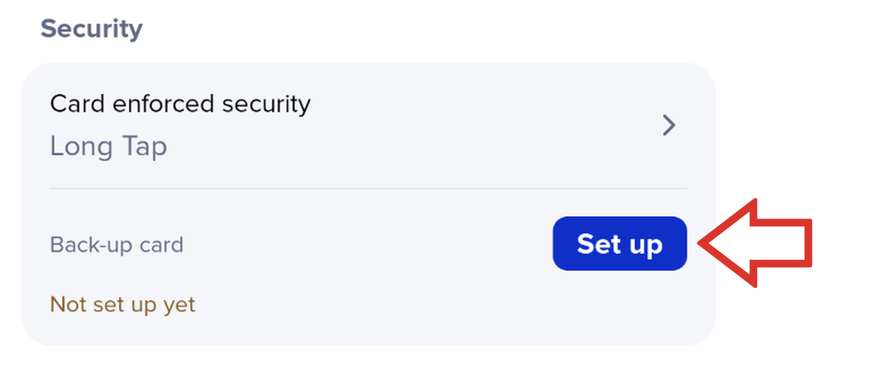

# Setting up a Backup card

A Backup card is your safety net. It is a second Xaman card that can sign for your Primary card account, so if one card is ever lost, stolen, or damaged, the other still gets you into your account. Setting one up takes a few minutes, and you do it right inside Xaman. This article walks you through it screen by screen.

The Backup card is not a copy of your Primary card. Each card keeps its own [account secret](#user-content-fn-1)[^1] inside its chip, and nothing is ever copied from one card to the other. Instead, Xaman uses an XRP Ledger feature called a [regular key](#user-content-fn-2)[^2], a second key that is allowed to sign for an account. Your Backup card becomes that second key for your Primary account, while your Primary card keeps full control.

### Before you get started

* Your Primary card's account, imported into Xaman and activated.
* Your second Xaman card. It does not need to be imported first, and it does not need any XRP.
* An up-to-date version of Xaman, on a phone with NFC[^3] turned on.

If your cards have just arrived, start with [Getting started with your new cards](getting-started.md), which covers importing and activating your Primary card.

### Set up your Backup card

You can start the setup from two places, and both lead to the same steps. Right after you activate your Primary account, its **Home** screen shows a **No back-up card configured** reminder.&#x20;

<figure><figcaption>
Tap the box to link your Backup card
</figcaption></figure>


You can also start at any time from **Settings** > **Accounts**: tap **Edit** next to your Primary card account, and tap **Set up** next to **Back-up card**. Always start from your Primary card's account, since that is the account your Backup card protects.


1. Tap **No back-up card configured** on your Primary account's **Home** screen, or **Set up** on its **Edit account** screen.

<figure><figcaption>
You can also start here at any time
</figcaption></figure>

2. Check that the card ID on the screen matches your Primary card.
3. Tap **Start**
4. Tap **Scan original card**.

<figure><figcaption>
Scan your Primary card first
</figcaption></figure>

5. Hold your Primary card against the back of your phone until the scan finishes.
6. Tap **Scan back-up card**.

<figure><figcaption>
Then scan your second card
</figcaption></figure>

7. Hold your second card against your phone until the scan finishes. If the card is new, it creates its own account during the scan, and Xaman adds it for you.
8. Check that both cards are shown, and tap **Continue**.

<figure><figcaption>
Both cards are ready to link
</figcaption></figure>

9. Tap **Confirm**.

<figure><figcaption>
Approve the link with your Primary card
</figcaption></figure>

10. Hold your Primary card against your phone once more to approve the link.
11. When **Back-up card linked** appears, tap **Done**.

<figure><figcaption>
Your Backup card is linked
</figcaption></figure>

Your Primary card approves the link, since only your Primary card can add a second key to its own account. Xaman then waits a moment while the XRP Ledger confirms it. Once you tap **Done**, the **No back-up card configured** reminder is gone, and the **Back-up card** line on your Primary account's **Edit account** screen shows your Backup card's name. That is your sign that both cards are ready to use.

### Which card to carry day to day

We recommend that you keep your Primary card somewhere safe, such as a safe, a safe deposit box, or a locked drawer, and carry your Backup card for everyday signing. The Primary card is the key to the account your money lives in, so it makes sense to keep it out of harm's way. If you lose the Backup card you carry, your Primary card can remove its link and still controls everything.

### If you lose a card

Losing one card is exactly what a Backup card protects you from, since the other card still gets you into your account. The steps depend on which card is missing, and [Lost or damaged cards](lost-or-damaged-cards.md) walks you through each case. One thing is worth doing right now, while both cards are in your hands: write down your Primary account's r-address[^4] and keep it somewhere safe. If you ever lose your phone and your Primary card together, you need it to reach your account with your Backup card.

Xaman is a self-custody[^5] wallet, so we cannot recover a lost card, freeze an account, or reverse a transaction for you. Our support team will never ask for your account secret, or ask you to tap a card to fix your account. Anyone who asks is trying to take your funds.

### Frequently asked questions

**Is my Backup card a copy of my Primary card?**

No. Each card keeps its own key, and nothing is copied between them. Your Backup card is only allowed to sign for your Primary account, the way a second key opens the same door.

**Can I link more than one Backup card?**

No. The XRP Ledger allows one regular key per account, so each account can have one Backup card. Extra cards are still useful as spares, ready to replace your Backup card if you ever need to.

**My Backup card's account says Not set up yet. Is my backup working?**

That line is about the Backup card's own account, not your Primary account, so it does not mean anything is wrong. Your Backup card signs for your Primary account, which is why the link lives on your Primary card's account. To check it, tap **Settings** > **Accounts**, then **Edit** next to your Primary card account: the **Back-up card** line shows your Backup card's name when the link is in place.&#x20;

**Can I use a regular XRP Ledger account as my backup instead of a card?**

You can, though we recommend a second card. If you still want to set one up, see [Rekeying your XRP Ledger account](../security/how-to-rekey-your-account.md).

**I cannot find where to set up my Backup card. What should I do?**

The setup inside Xaman needs an up-to-date version of the app, so update Xaman from the App Store or Google Play first. Then look under **Settings** > **Accounts**, on your Primary card account's **Edit account** screen. If something still looks wrong, contact us through the [Xaman Support xApp](https://xaman.app/detect/xapp:xumm.support-md), the only official way to reach us.

### See also

* [Getting started with your new cards](getting-started.md)
* [Xaman cards](xaman-tangem-cards.md)
* [Lost or damaged cards](lost-or-damaged-cards.md)
* [How to import your Xaman card](...a-xaman-tangem-card.md)
* [Best security practices for the Xaman cards](best-security-practices-using-a-xaman-card.md)
* [Rekeying your XRP Ledger account](../security/how-to-rekey-your-account.md)

[^1]: The secret that controls your account, as Secret Numbers, a Family Seed, or a Mnemonic. Never share it with anyone.

[^2]: A second key that can sign for your account, such as a Backup card.

[^3]: The technology your phone uses for tap-to-pay. Xaman uses it to talk to your Xaman cards.

[^4]: Your account's address on the XRP Ledger. It always starts with "r", and it is safe to share.

[^5]: You alone hold the keys to your account. No company, including Xaman, can move, freeze, or recover your funds for you.
