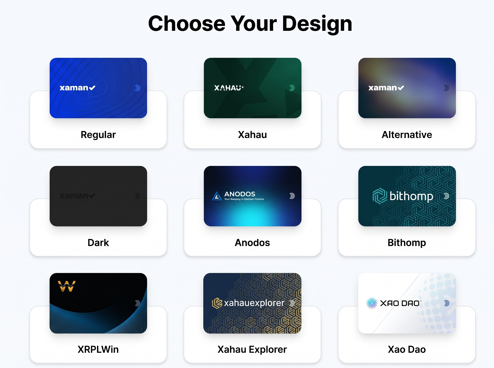

# Are my Xaman Cards safe?

You ordered your Xaman cards directly from us. They arrived, but something looks different from what you expected:

* the cards are loose in the package
* the package is cut open
* one card has a clear plastic sleeve and the others do not
* one card has a hand-written note on it

Nothing you are seeing means your cards are unsafe. This article answers the questions we get most often.

#### Why are the cards loose in the package?

Your cards come from the factory in plain bulk boxes, not in individual packages. When your order is ready, we take the cards out of that box and ship them in a sealed pouch. Loose cards in the pouch are normal.

#### Why is each card not individually packaged?

We ship cards together in a single, minimalist pouch for several practical reasons:

* **Direct cost savings**: Custom retail packaging adds unnecessary manufacturing overhead. Omitting it allows us to pass those savings straight to you and keep card prices as low as possible.
* **Less single-use waste**: Individual retail packaging is typically discarded immediately. Using simple, shared packaging significantly cuts down on material waste.
* **Customer-driven choice**: When surveyed, our community overwhelmingly preferred lower card prices over paying extra for branded presentation boxes.
* **Resale deterrence**: Unbranded packaging helps discourage scalpers and unauthorized third parties from marking up and reselling individual cards.

#### Why does one card have a clear plastic sleeve but the others do not?

The sleeve marks your pre-funded card. There should be a label on it saying,

"THIS IS THE CARD WITH\
PRE PAID XRP\
Import this card first, and tap the\
"Activate Card" button"\
\
We put it in a sleeve with a label so you can tell at a glance which card to import first.

The sleeve does not change the card.&#x20;

#### Why do the cards have different colours or designs?

When you order the cards, you have the option to select from a few different colors and styles, which means a single order can include a mix of different card designs.

<figure><figcaption></figcaption></figure>

Please rest assured that these differences are strictly cosmetic. The color or artwork on the cards does not change how the card work. Every single card in your order functions exactly the same way and provides the same high-level security in the Xaman app.

#### Why was my package opened by customs, and are my cards still safe?

International packages are sometimes inspected by customs authorities to verify that the physical contents match the attached commercial invoice. A clean cut along the pouch seal or outer mailer is a standard indicator of an official inspection.

Your cards are completely safe and secure:

* **No pre-loaded secrets**: Brand-new cards do not contain private keys, wallet secrets, or pre-configured accounts. Keys are generated only when you personally initialize the card inside the Xaman app.
* **Nothing to intercept**: Because an uninitialized chip holds zero account data, there is no sensitive information for anyone to read, copy, or steal.
* **Cryptographic verification**: Physical tampering cannot bypass on-chip security. The moment you first tap the card to your phone, the Xaman app automatically validates the chip's cryptographic integrity to confirm it is genuine and untouched.

#### How do I know the cards have not been tampered with?

Three layers protect you.

1. **A new card holds no account secret.** Your account secret is created inside the card when you set it up. Opening a package cannot copy something that does not exist yet.
2. **The card itself cannot be altered.** Our cards cannot be physically modified. The firmware on the cards can not be modified. Xaman can accurately verify that it was originally produced by Tangem for us and that our firmware was installed on it.
3. **The final check is in the app, on every card, every time.** When you first tap a new card, the Xaman app verifies that the card was made by Tangem and that it runs our firmware. The app then shows:

<figure><figcaption></figcaption></figure>

If a card was used before you, the app shows a warning instead:

<figure><figcaption></figcaption></figure>

If you see that warning on a card you just received, stop. Do not import that card. Contact [**Xaman Support**](https://xaman.app/detect/xapp:xumm.support-md) before you do anything else.

#### How do I get started configuring the cards?

The full step-by-step guide can be found here: [Getting started with your new cards](../xumm-tangem-cards/getting-started.md). The short version:

1. Install or update the official Xaman app from the App Store or Google Play.
2. Make sure NFC is on.
3. Tap **Settings**, then **Accounts**, then **+ Add account**.
4. Tap **Add Tangem card** and hold the card against the back of your phone.
5. Tap **Generate account**, then **Verify** when the app asks.
6. Confirm the r-address and give the account a name.

If your order includes a pre-funded card, import that card first. After import, the app shows an **Activate** button that claims your pre-funded 1 XRP.

Most people import a second card as a backup. If you lose or damage the first card, the backup card still controls the same account. The import guide covers this too.

#### See also

* [Getting started with your new cards](../xumm-tangem-cards/getting-started.md)
* [How to import your Xaman card](../getting-started-with-xaman/importing-your-account/...a-xumm-tangem-card.md)
* [What is a "Pre-funded" Xaman card?](../getting-started-with-xaman/how-to-activate-a-new-xrpl-account/what-is-a-pre-funded-xaman-card.md)
* [How to configure a backup signing account](../xumm-tangem-cards/how-to-configure-a-backup-signing-account.md)
