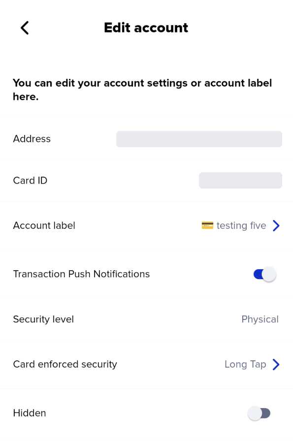
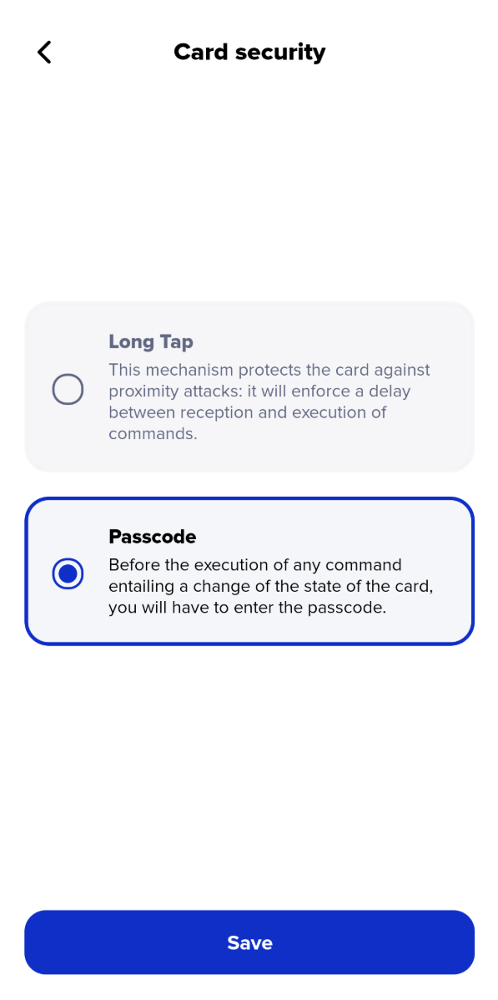
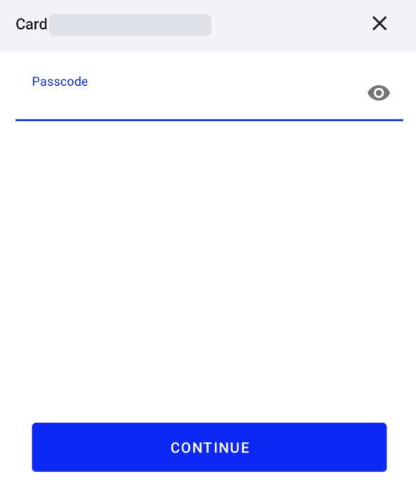
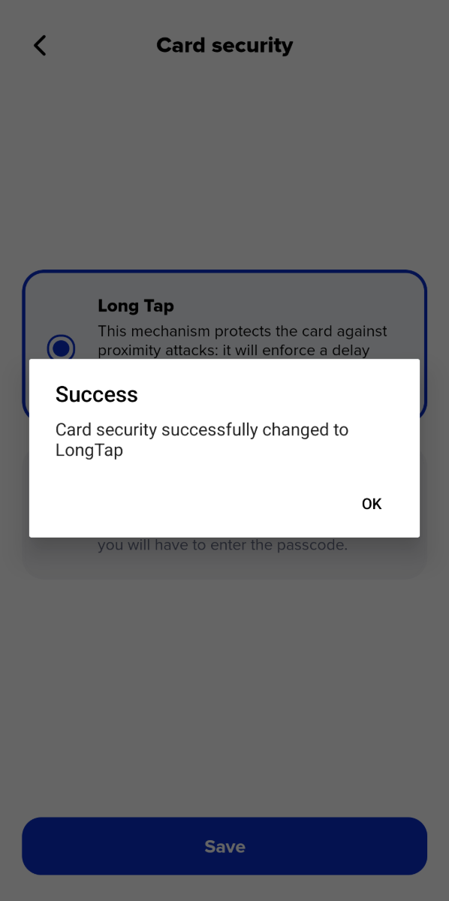
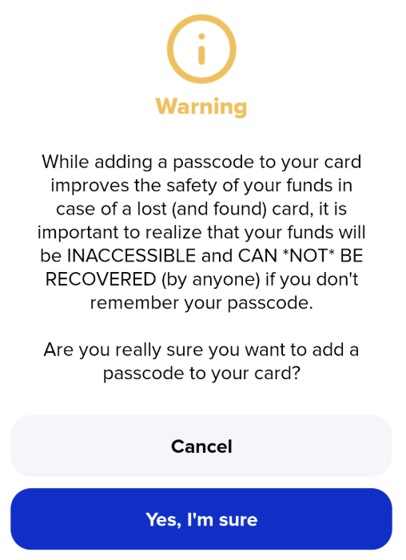

# PINs on older Xumm/Xaman cards


**New Xaman cards do not support PINs.** If you received your cards recently, there is nothing to set up here. To keep your new cards secure, see [Best security practices for the Xaman cards](https://help.xaman.app/app/xaman-tangem-cards/best-security-practices-using-a-xaman-card).


#### Which cards does this apply to?

This article only applies to **first-generation cards**. These cards let you set a PIN, which Xaman calls a **passcode**. Once a passcode is set, you have to enter it before the card can sign or change its settings.

Older and newer cards look the same, so the only way to tell is to check in Xaman:

1. Go to **Settings**, then **Accounts**.
2. Tap **Edit** next to your card account.
3. If you see **Card enforced security**, your card supports passcodes. If you do not, your card is a newer card and does not support them.

<figure><figcaption>
Card enforced security on an older card
</figcaption></figure>

Xaman will keep supporting older cards, including their passcodes, in all future versions of the app.

#### Long Tap and Passcode

**Card enforced security** has two settings:

* **Long Tap** is the default. It adds a short delay before the card carries out a command, which protects your card if someone tries to use it from a distance.
* **Passcode** asks for your passcode before the card carries out any command that changes it.

<figure><figcaption>
The two Card enforced security settings
</figcaption></figure>

#### Why we removed the PIN feature

A passcode adds a layer of protection if someone steals your card. But there is no way to reset or recover a forgotten passcode. When customers forgot their passcode, some of them lost access to their funds for good.

We decided that risk was too high, so new cards do not support passcodes. Instead, the best protection for your cards is a [Backup card](https://help.xaman.app/app/xaman-tangem-cards/getting-started) and keeping your cards physically safe.

#### If you already set a passcode

Your passcode still works, and you still need it to use that card. **We recommend switching back to Long Tap**, so a forgotten passcode can never lock you out:

1. Go to **Settings**, then **Accounts**.
2. Tap **Edit** next to the card account with the passcode.
3. Select **Card enforced security**.
4. Select **Long Tap**, then tap **Save**.
5. When Xaman asks, tap your card. Then enter your current passcode and tap **Continue**.

<figure><figcaption>
Enter your current passcode, then tap Continue
</figcaption></figure>

A message confirms that your card security has changed to Long Tap.

<figure><figcaption>
Your card is back on Long Tap
</figcaption></figure>

If you decide to keep your passcode:

* **Write it down** and keep it somewhere secure, separate from the card.
* **Make sure the account has a Backup card.** If you forget the passcode on a card that has no backup, you lose access to the funds on that account. If your card has a passcode but no backup, link a Backup card **now**, while you still remember your passcode. See [How to configure a backup signing account](https://help.xaman.app/app/xaman-tangem-cards/how-to-configure-a-backup-signing-account).

#### If you forget your passcode

There is no reset and no "back door," and Xaman Support cannot recover a passcode for you. What you can do depends on which card has the passcode:

* **If the passcode is on your Backup card**, your funds are safe. Use your Primary card to remove the link to the Backup card, then link a new Backup card.
* **If the passcode is on your Primary card**, use your Backup card to move your funds to another account.
* **If the card has no Backup card**, there is unfortunately no way to access the funds on that account.

See [Lost or damaged cards](https://help.xaman.app/app/xaman-tangem-cards/lost-or-damaged-cards) for step-by-step help. A card with a forgotten passcode works the same way as a lost card.

#### Setting a passcode on an older card


We strongly recommend that you **do not** set a new passcode. If you choose to set one anyway, only do it on a card whose account has a Backup card.


1. Go to **Settings**, then **Accounts**.
2. Tap **Edit** next to the card account.
3. Select **Card enforced security**.
4. Select **Passcode**, then tap **Save**.
5. Xaman warns you that a forgotten passcode cannot be recovered. Read it carefully, then tap **Yes, I'm sure** to continue.

<figure><figcaption>
The warning Xaman shows before you  set a passcode
</figcaption></figure>

6. When Xaman asks, tap your card. Then enter your new passcode twice and tap **Save**.

A message confirms that your card security has changed to Passcode.

#### Questions?

If you have questions about a passcode on your card, contact us through the [Xaman Support xApp](https://xaman.app/detect/xapp:xumm.support-md) in Xaman.
