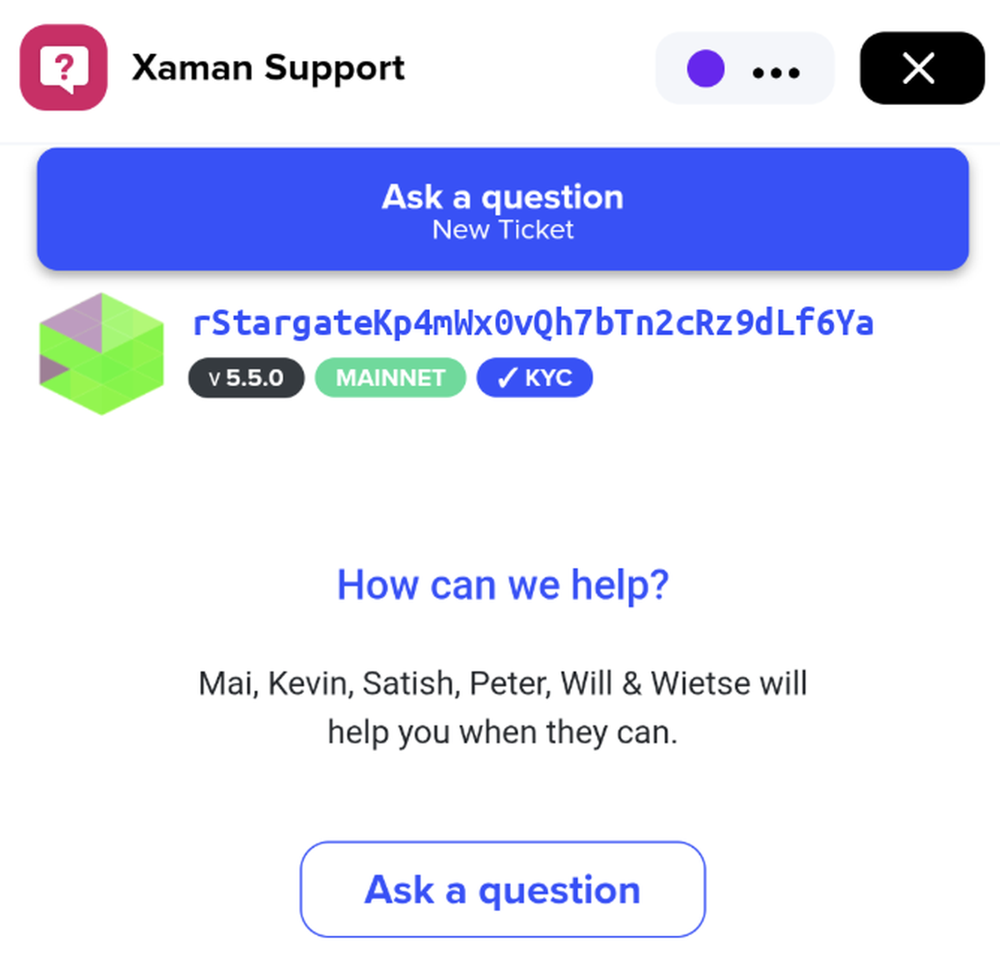

# Xaman Support

## Xaman Support

How to reach our support team, and what to include so we can help quickly

When something in Xaman is not working the way you expect, our support team is here to help. You reach us through the Xaman Support xApp, inside Xaman itself. It is the only official way to contact us, so you always know the person answering really is from XRPL Labs. It works the same way whether you use the XRP Ledger (XRPL) or Xahau.

The xApp first shows you answers to the questions people ask most, since one of them may solve your problem right away. If not, you can send us a ticket. This article walks you through both, and explains what to include so we can help you on the first reply.

<a href="https://xaman.app/detect/xapp:xumm.support-md" class="button primary">Get help from Xaman Support</a>

### Open the Xaman Support xApp

1. Tap **xApps** in the bottom navigation bar.
2. Tap **Xaman Support** under **Our suggestions**.

You can also tap **Settings** > **Questions & Support**, which opens the same xApp.

<figure><figcaption>
The Xaman Support xApp
</figcaption></figure>

At the top, the xApp shows the r-address[^1] of the account you have open, your Xaman version, and the network. If your question is about a different account, include that account's r-address in your message.

### Check the most asked questions

Tap **Ask a question**. Before the ticket form, Xaman Support shows the questions people ask most, each with a **Read** button, and an **Explore the Help Center** link with an **Open** button. It only takes a moment to check them, and if one of them fits, you have your answer straight away.

### Send a ticket

If none of the questions fit, send us a ticket.

1. Tap **Send ticket anyway**.
2. Under **Subject**, enter what your ticket is about, in at least 12 characters.
3. Under **Message**, describe your question in at least 40 characters.
4. To add screenshots or a short video, tap **Add screenshots** and select them.
5. Tap **Submit Ticket**.

A confirmation appears with your ticket number, and it says we will reply within one working day.

### Follow your ticket

When we reply, Xaman lets you know in two places: a notification on your phone, and an entry in **Events** saying your ticket has been updated. Your open tickets are listed under **Pending** on the Xaman Support home screen, with their subject and ticket number, so you can always find them again.

To read our reply and answer it:

1. Open the Xaman Support xApp.
2. Under **Pending**, tap your ticket.
3. Tap **Write a reply**.
4. Enter your reply. To add a screenshot, tap **Add screenshots**.
5. Tap **Submit reply**.

If we ask for a session log, our reply shows an **Upload Session Log** button. Tap it, and Xaman asks whether to share the log, so tap **Continue**. A session log holds no personal information apart from your account addresses and a record of Xaman's connections to the network. To see what is in it first, tap **Settings** > **Advanced** > **Session Log**.

When your question is answered, tap **Close ticket**.

### What to include

The more we know, the faster we can help, and the form itself suggests what to cover. A good ticket includes:

* What you were trying to do, and what happened instead.
* Where it happened: in Xaman, or on another website or app.
* Any error message, copied word for word.
* The steps that lead to the problem, so we can try them ourselves and see it happen.
* The [transaction ID](#user-content-fn-2)[^2], if your question is about a transaction.
* A screenshot, especially of an error message, so we see exactly what you see.
* A short video of the problem, if it is easier to show than to describe. A few seconds of screen recording often tells us more than a long message.

You add both with **Add screenshots**, which also lets you choose a video from your phone. [How to take a screenshot](../../using-the-xaman-app/how-to-take-a-screenshot.md) explains how to capture your screen in Xaman. Check each one before you send it, and make sure it never shows your account secret.

If Xaman is crashing or behaving strangely, a session log helps us see what went wrong. [How to post a Session Log](../../using-the-xaman-app/how-to-post-a-session-log.md) explains how to add one to your ticket, and _Follow your ticket_ covers the button we send when we ask for one.


Your account secret controls your account and its funds. Anyone who sees it can take everything in the account, and our support team never needs it. Never put it in a ticket, a message, or a screenshot.


### What our support team can and cannot do

We can explain how Xaman and the XRP Ledger work, look into problems with the app, and help you find out what happened to a transaction, using what the XRP Ledger shows publicly and the details you send us.

Xaman is a self-custody[^3] wallet, so some things are outside what anyone at XRPL Labs can do. We cannot see or recover your account secret, reverse or cancel a transaction, freeze an account, or move funds for you. When another company is involved, such as an exchange or a token issuer, their support team is often the one who can fix it, and we can help you work out what to ask them.

### Stay safe when you ask for help

People who have just lost funds or hit a problem are a favorite target for scammers, so be careful who you take help from. Our support team will never ask for your account secret. Anyone who asks for it is trying to take your funds, so never share it.

We only answer through the Xaman Support xApp. We do not offer support through social media, direct messages, or phone calls, and we never contact you first. [Official communication channels](../../scams-and-staying-safe/official-communication-channels.md) lists where to find the real Xaman, and [Recovery scams](../../scams-and-staying-safe/recovery-scams.md) explains the fake services that promise to get lost funds back.

### Frequently asked questions

**How much detail should I put in my ticket?**

Enough for us to picture what is going on, without writing a novel. "It's not working" does not give us anything to go on, while "The Send screen shows an error when I enter a Destination Tag" points us straight at the problem. A few clear sentences about what you did, what you expected, and what happened instead is usually perfect.

**Do I need to tell you how to make the problem happen again?**

If you can, yes. It is one of the most helpful things you can send. List the steps in order, such as which screen you opened, what you tapped, and what you saw, so we can follow them ourselves. The more detail you give us here, the faster we can find the cause.

### See also

* [How to post a Session Log](../../using-the-xaman-app/how-to-post-a-session-log.md)
* [Official communication channels](../../scams-and-staying-safe/official-communication-channels.md)
* [Recovery scams](../../scams-and-staying-safe/recovery-scams.md)
* [Can Xaman reverse, freeze or undo a transaction?](../../sending-receiving-and-cashing-out/can-xaman-reverse-freeze-or-undo-a-transaction.md)
* [I've lost my account secret](../../security/ive-lost-my-account-secret.md)

[^1]: Your account's address on the XRP Ledger. It always starts with "r", and it is safe to share.

[^2]: A transaction's unique ID, also called a transaction hash. It helps you find the transaction in an explorer, or show support which one you mean.

[^3]: You alone hold the keys to your account. No company, including Xaman, can move, freeze, or recover your funds for you.
