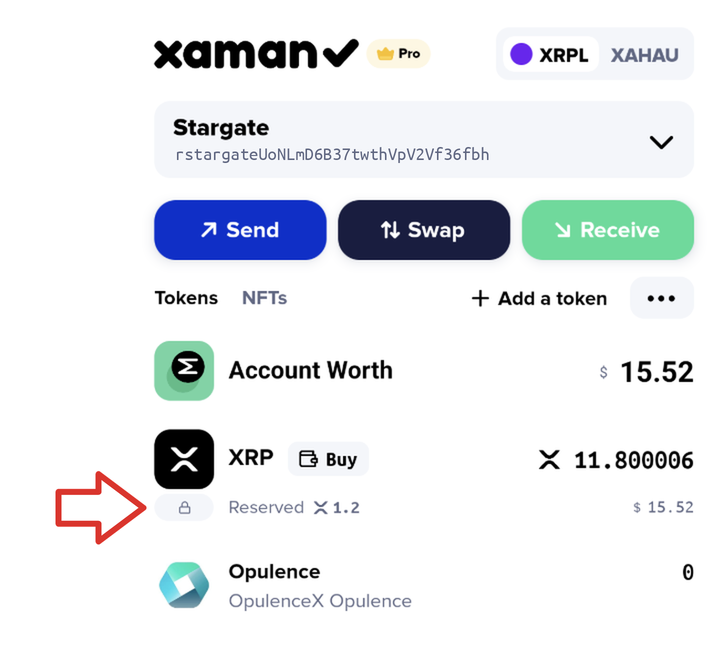
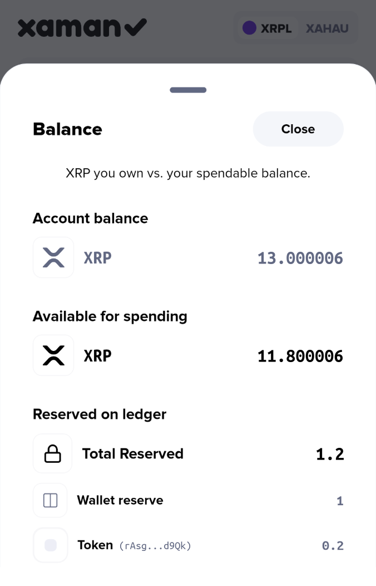

# Reserves on the XRP Ledger

### Background

Every account on the XRP Ledger (XRPL) must hold a minimum amount of XRP, called a reserve. The XRP Ledger sets this XRP aside, so you cannot send or spend it.

Reserves keep the XRP Ledger small and fast. Creating accounts and objects costs XRP, which makes spam expensive and stops the ledger from filling up with unused data.

Reserves are part of the XRP Ledger, not Xaman. The reserved XRP stays in your account, and Xaman never holds or touches it.

### The two kinds of reserve

The XRP Ledger has two kinds of reserves:

* The base reserve is the minimum every account must hold. Your account cannot exist on the XRP Ledger without it.
* The owner reserve is an extra amount for each object your account owns, such as a trust line or an escrow.

The validators that run the XRP Ledger can vote to change both amounts. Over the years, they have lowered them several times. To see the current amounts for your account, see [_See your reserves in Xaman_](about-reserves.md#see-your-reserves-in-xaman).

### Objects that need an owner reserve

Each of these objects adds one owner reserve to your account:

* A trust line to a token.
* An open offer on the decentralized exchange (DEX).
* An escrow.
* A check.
* A payment channel.
* A signer list, for multi-signing.
* An NFT page. Each page holds up to 32 NFTs, so several NFTs can share one reserve.

Some newer objects also need an owner reserve, such as Multi-Purpose Tokens (MPTs). For the full list, see the [reserves page](https://xrpl.org/docs/concepts/accounts/reserves) on xrpl.org.

### See your reserves in Xaman

1. On the home screen, tap **Reserved** under your XRP balance.

<figure><figcaption></figcaption></figure>

2. Check the amount of XRP you can spend (Available for spending) and the list of objects that hold reserves. (Reserved on ledger)

<figure><figcaption>
Reserved XRP and the objects that hold it
</figcaption></figure>

### Release an owner reserve

When you remove an object from your account, the XRP Ledger releases its owner reserve. The XRP becomes spendable again.

To remove an object:

* Trust line: send or remove the token balance first, then remove the trust line. See [_How to remove a Trust Line_](../../all-about-xapps/xrpl-services/token-trasher/how-to-remove-a-trust-line.md).
* Offer: cancel the offer on the DEX.
* Escrow: finish or cancel the escrow. See _How to release an escrow_.
* NFT page: remove every NFT on the page, by selling, sending, or burning them. See [_How to Burn an NFT_](../../learning-more-about-xumm/nfts/nft-burn-process.md).

### Recover the base reserve

The only way to recover the base reserve is to delete your account from the XRP Ledger. Deleting an account costs a special transaction fee, which is much higher than a normal transaction fee.

Before you can delete your account, you need to remove every object it owns. See [_How to delete an XRPL account_](../../your-account/importing-your-account/how-to-delete-an-xrpl-account.md).

### Frequently asked questions

**Does Xaman set the reserves?**

No. The XRP Ledger sets the reserves, and its validators can vote to change them. Every wallet shows the same reserves for the same account.

**Where does my reserved XRP go?**

It stays in your account. The XRP Ledger marks it as un-spendable until you remove the object it covers, or delete the account.

**Why can't I send all of my XRP?**

Your account must always keep its reserves. You can send any XRP above them, minus a small network fee.

**Can the reserves change?**

Yes. The validators can vote to raise or lower the base reserve and the owner reserve. When they change, the reserved amount in your account changes automatically.

### See also

* [How to delete an XRPL account](../../your-account/importing-your-account/how-to-delete-an-xrpl-account.md)
* [How to remove a Trust Line](../../all-about-xapps/xrpl-services/token-trasher/how-to-remove-a-trust-line.md)
* [What are Trust Lines?](../../tokens-trust-lines-and-nfts/trust-lines-on-the-xrp-ledger.md)
* [Reserves on xrpl.org](https://xrpl.org/docs/concepts/accounts/reserves)
