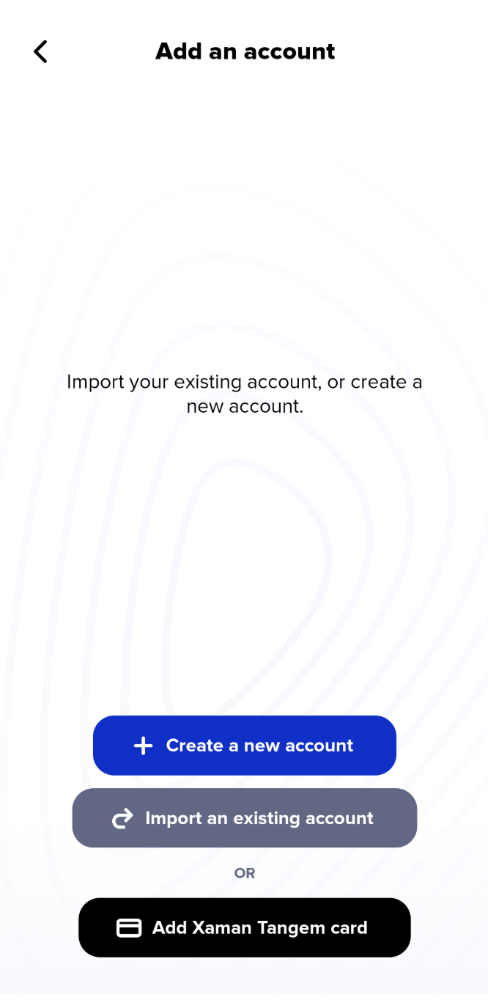
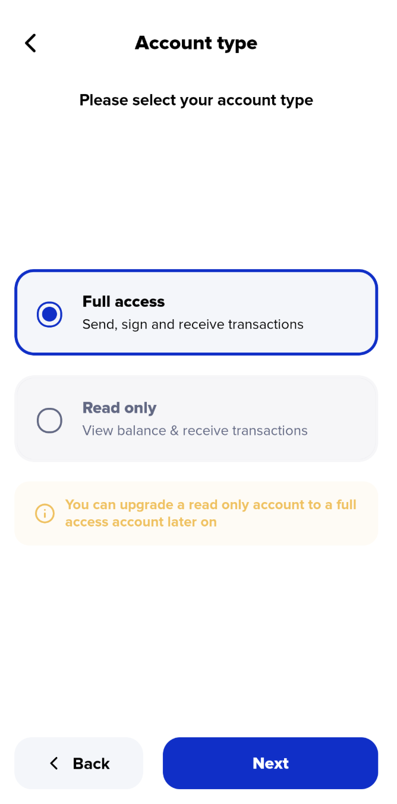
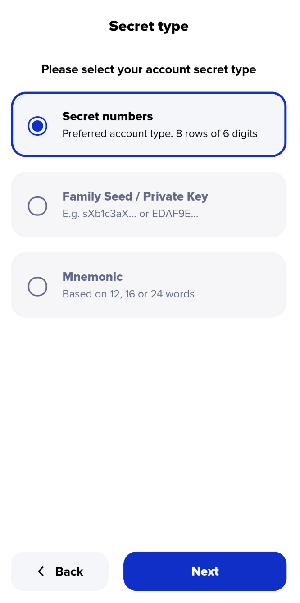
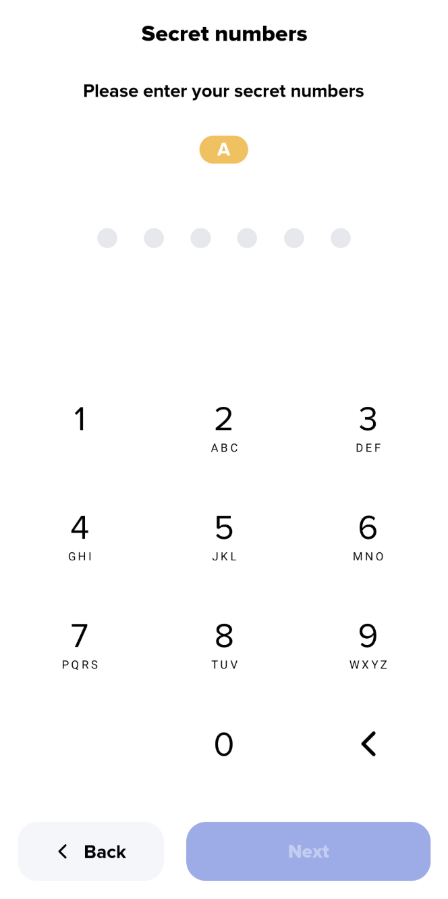

# How to import your Secret Numbers

### Background

If you created your XRP Ledger account in Xaman, or in Xumm before it, you were given a set of Secret Numbers: eight rows of six digits, labeled A to H. They are your account's [account secret](#user-content-fn-1)[^1], and entering them in Xaman gives you access to your account, on a new phone or after reinstalling the app. This article walks you through importing them, and explains what makes them different from other account secrets.

Xaman is a self-custody[^2] wallet. The moment you import your Secret Numbers, Xaman encrypts them and stores them in the secure chip on your phone, where no one can view them, not you and not the Xaman team. That is why Xaman cannot show them to you again or recover them. Your written copy is the only one you can read, so keep it safe, and keep it private.

### About Secret Numbers

Secret Numbers were designed by XRPL Labs, the team behind Xaman, as an easier and safer way to write down an account secret. The older formats, a family seed and a recovery phrase, are easy to mistype, and a recovery phrase depends on knowing the words of one language. Numbers work the same in every language, and they are hard to confuse with each other.

Each row of six digits holds five digits of your secret, plus one check digit at the end. The check digit is calculated from the other five and from the row's position, A to H. That means Xaman can catch many typos, and many rows entered in the wrong place, right away, before you ever see the wrong account.

### Before you get started

Check that you have these ready:

* Your Secret Numbers, all eight rows.
* A private place where nobody can see your screen or your paper.
* The latest version of Xaman.


Anyone who sees your Secret Numbers can take everything in your account. Enter them only in the Xaman app, never in a website, a form, or a message. Xaman support never asks for them.


### Import your account

To import your account with its Secret Numbers:

1. Tap **Settings** > **Accounts**.
2. Tap **+ Add account**.
3. Tap **Import an existing account**.
4. Choose **Full access**, then tap **Next**.
5. Choose **Secret numbers**, then tap **Next**.
6. Enter row A on the keypad, then tap **Next**. Repeat for rows B to H.
7. Check that the r-address shown is the account you expect, then tap **Confirm**.
8. Choose a security level, then tap **Next**.
9. Enter a name for the account, then tap **Next**.

<figure><figcaption>
Choose Import an existing account
</figcaption></figure>

<figure><figcaption>
Full access lets you sign transactions
</figcaption></figure>

<figure><figcaption>
Choose the type of secret you wrote down
</figcaption></figure>

<figure><figcaption>
Each row is checked as you enter it
</figcaption></figure>

<figure><figcaption>
Make sure this is the account you expect
</figcaption></figure>

If you only want to watch an account without signing for it, choose **Read only** in step 4 instead. See [How to import an account in Read Only mode](...in-read-only-mode.md).

### If Xaman shows a different r-address

The correct Secret Numbers always lead to the same account. Entered correctly, they always give the same r-address, with your balance and tokens in place. If Xaman shows an r-address you do not recognize, often with no balance at all, the numbers you entered belong to a different account, usually a new one that has never been activated. Your own account is fine. You have simply reached a different one.

If you see this at step 7, tap **Back** and check your numbers before you continue. If you already imported the account, you can remove it from Xaman without any harm. See [How to remove an account from Xaman](../how-to-remove-an-account-from-xaman.md).

There are three possible reasons:

* **A number was written down wrong when the account was created.** Look closely at your paper for digits that are easy to confuse, such as 1 and 7, 6 and 8, or 3 and 8.
* **A number was entered wrong.** Every digit must be correct, in the correct spot, in the correct row. The check digits catch many mistakes, but not all of them, so one wrong digit can still lead to a different account.
* **The Secret Numbers belong to another account.** Every XRP Ledger account has its own account secret. If you have created more than one account, it is easy to mix up which Secret Numbers belong to which.

To find your account:

1. Enter your Secret Numbers again, slowly, comparing each row with your paper.
2. If you still see a different r-address, look for a digit you are unsure of, swap it for its look-alike, and try again. Change one digit at a time.
3. Look for any other account secrets you have written down, and try those.

The only way into your account is its correct account secret. No one can work it out for you, including Xaman. If none of these steps work, see [I've lost my account secret!](../../learning-more-about-xaman/ive-lost-my-account-secret.md) for your options. If you have questions along the way, we are happy to help.

<a href="https://xaman.app/detect/xapp:xumm.support-md" class="button primary">Open the Xaman Support xApp</a>

### Choosing a security level

Xaman asks how you want to sign transactions for this account:

* **Standard security: best for an everyday account.** You sign with your Xaman passcode, or with your face or fingerprint if you turn on biometrics.
* **Extra security: best for long-term savings.** You set a separate signing password for this account, and you enter it each time you sign. If you ever forget it, you can reset it with your Secret Numbers. See [Resetting the (account) signing password](../../learning-more-about-xumm/resetting-the-account-signing-password.md).

<figure><figcaption>
Extra security adds a password for this account only
</figcaption></figure>

### Frequently asked questions

**Xaman says a row is not valid. What does that mean?**

The check digit at the end of the row does not match the other five, so something in that row is wrong. Check it digit by digit against your paper. Also make sure you are entering the row in the right place: row C goes in row C. A row in the wrong position usually fails the check, even if every digit is right.

**Can I use my Secret Numbers in another wallet?**

Secret Numbers are an open standard, but most other wallets use a family seed or a recovery phrase instead. You can convert your Secret Numbers into a family seed. See [Moving your XRPL account to another wallet](moving-your-xrpl-account-to-another-wallet.md).

**I have lost my Secret Numbers. What can I do?**

If your account is still in Xaman on another phone, you can still use it there. Otherwise, no one can recover the account, including Xaman. See [I've lost my account secret!](../../learning-more-about-xaman/ive-lost-my-account-secret.md) for your options.

### See also

* [Should I import my XRP Ledger account into Xaman?](should-i-import-my-xrp-ledger-account-into-xaman.md)
* [How to import your Family Seed](...with-a-family-seed.md)
* [How to import your Mnemonic](...with-a-mnemonic.md)
* [How to Test or Verify your Account Secret](../../learning-more-about-xaman/how-to-test-your-account-secret.md)
* [I've lost my account secret!](../../learning-more-about-xaman/ive-lost-my-account-secret.md)

[^1]: The secret that controls your account, as Secret Numbers, a family seed, or a recovery phrase. Never share it with anyone.

[^2]: You alone hold the keys to your account. No company, including Xaman, can move, freeze, or recover your funds for you.
